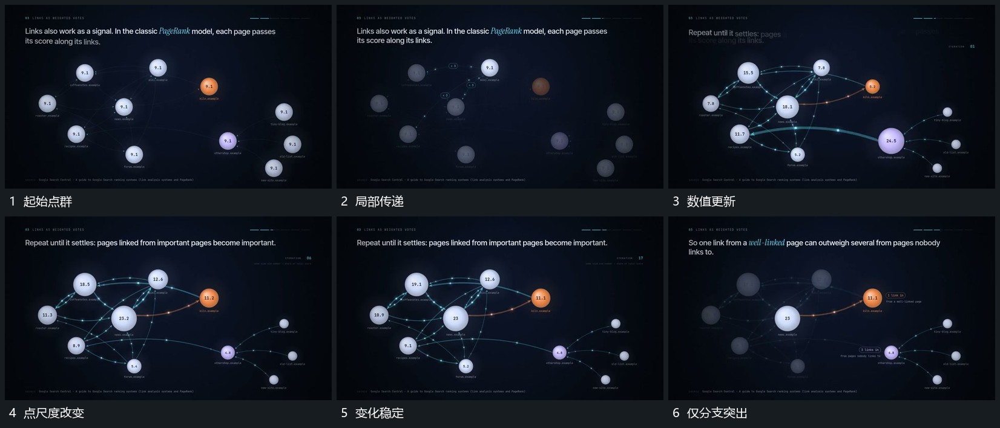

# 点间局部传递，数值与尺度更新后突出一条分支

## 运动指令

在已有点群连接上让局部亮点或短反馈沿线推进，点内数值持续更新，主要点尺度逐渐增加。变化到稳定状态后只保留一条分支清楚，其他点和线退弱但位置保留。

## 视频切片

[播放本机制的原片切片](m03.mp4)

覆盖分镜中“起始点群”至“仅分支突出”的连续过程，并保留邻近的前后衔接画面；原片中交叠发生的动作一并保留。

## 分镜过程

## 组合与调整

不声称实现原片计算模型，数值与尺度关系在新片重新确定。
