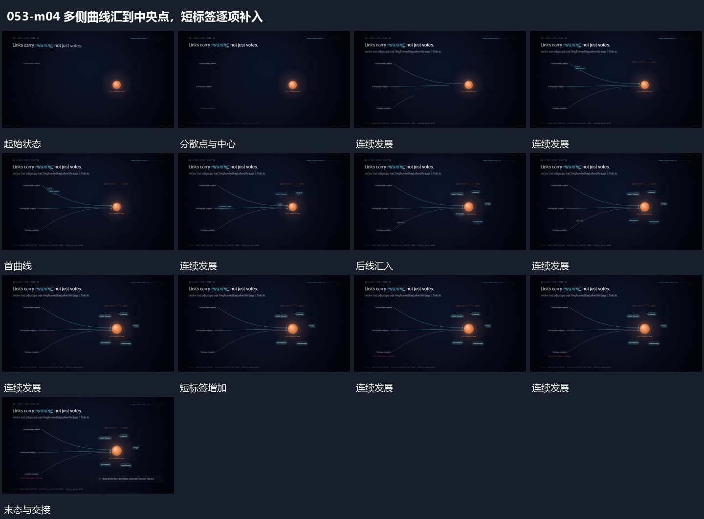

# 多侧曲线汇到中央点，短标签逐项补入

## 运动指令

从多侧已有局部延伸曲线，汇到同一中央主点。主点保持，连接齐全后在其周围逐项补入短标签，附属反馈条最后接入。

## 视频切片

[播放本机制的原片切片](m04.mp4)

覆盖分镜中“分散点与中心”至“附属条接入”的连续过程，并保留邻近的前后衔接画面；原片中交叠发生的动作一并保留。

## 分镜过程

## 组合与调整

可改变点与标签数量，保留多侧到一个中心的共同关系。
