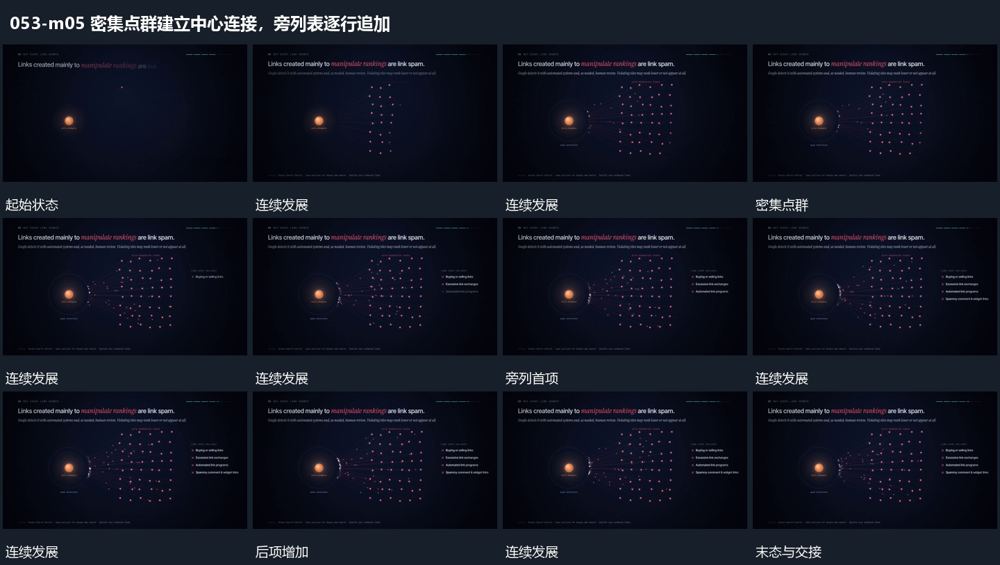

# 密集点群建立中心连接，旁列表逐行追加

## 运动指令

保留中心点，逐步铺开旁侧密集点群，在点群与中心之间补入多条连接。点群建立后在侧边逐行追加短列表，前项保持，最后整体稳定。

## 视频切片

[播放本机制的原片切片](m05.mp4)

保留起始准备、连续发展和完成或明确交接；首尾按本段运动范围裁切，不拼接、不变速。尾部只保留理解结果所需的展示。

## 分镜过程

## 组合与调整

抽帧未明确显示每条线的传递方向，指令只规定连接建立，不虚构流向。
