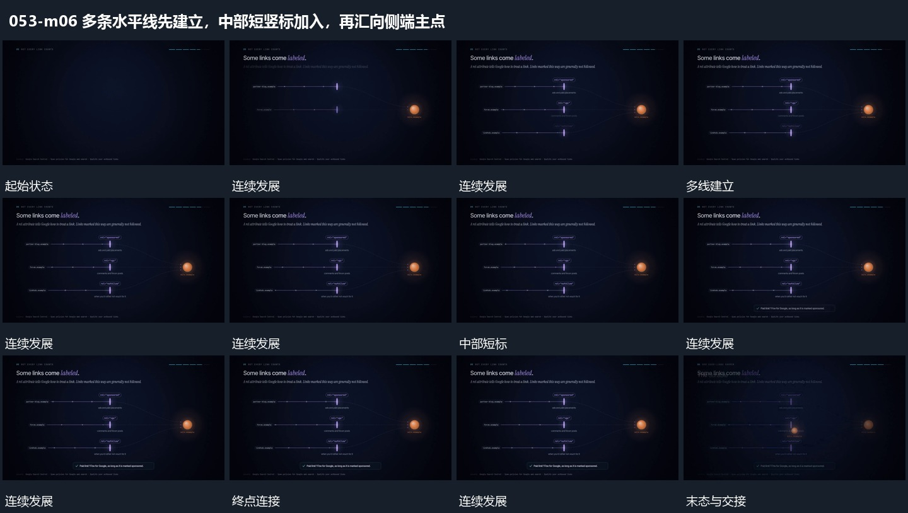

# 多条水平线先建立，中部短竖标加入，再汇向侧端主点

## 运动指令

先建立多条水平线，在各线中部追加短竖标。水平线侧端逐步接到同一主点，局部短标签再补齐，完整后退出并接入下一组分散节点。

## 视频切片

[播放本机制的原片切片](m06.mp4)

覆盖分镜中“首水平线”至“新组接替”的连续过程，并保留邻近的前后衔接画面；原片中交叠发生的动作一并保留。

## 分镜过程

## 组合与调整

不推定原片门控功能，保持并行路径与共同终点关系。
