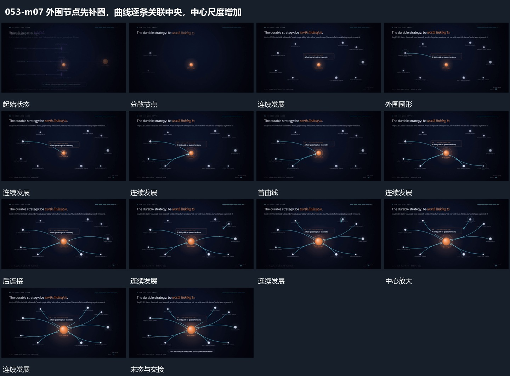

# 外围节点先补圈，曲线逐条关联中央，中心尺度增加

## 运动指令

保留分散节点，先为部分外围点补局部圈形，再逐条延伸曲线关联中央。连接增加时中央点逐渐放大，外围点位置保留，完整网络保持后交给结尾字组。

## 视频切片

[播放本机制的原片切片](m07.mp4)

覆盖分镜中“分散节点”至“完整保持”的连续过程，并保留邻近的前后衔接画面；原片中交叠发生的动作一并保留。

## 分镜过程

## 组合与调整

避免外围点都跟着中心放大。中央突出来自关联累积后的阶段变化。
