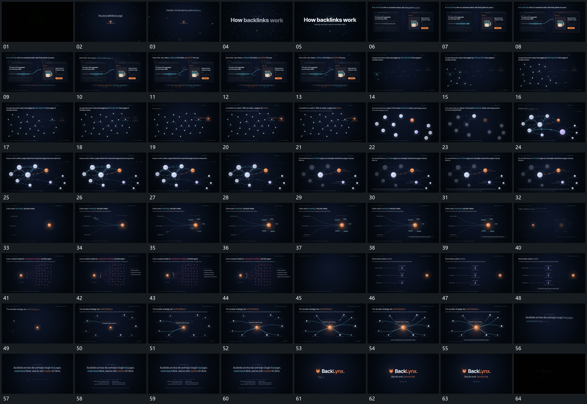

# 053｜原片运动总览

[观看完整原片](video.mp4)

## 运动总览

开头中央小点与短字建立，更多点进入视野后主字接管。两片间连线逐步延伸，终点片的局部边界随后建立 在两片间延伸连接线，终点局部边界随后建立。分散点依次点亮，点间连线累计成网络 将分散点逐步点亮，并在点间追加连接，网络从少到多建立。

中段 点间局部传递，数值与尺度更新后突出一条分支 让各点沿连接发生局部传递，点内数值更新、尺度变化，最后仅突出一个分支，其余退弱。多侧曲线汇到中央点，短标签逐项补入 从多侧延伸曲线汇到中央主点，旁侧短标签逐项出现。密集点群建立中心连接，旁列表逐行追加 建立密集点群与中心连接，旁侧列表分行追加。多条水平线先建立，中部短竖标加入，再汇向侧端主点 多条水平线先立起，中部短竖标加入，线的侧端再汇向主点。

末段 外围节点先补圈，曲线逐条关联中央，中心尺度增加 在分散节点周围先补局部圈，再延伸多条曲线关联中央，中央扩大，其余节点仍可见。最后网络退去，字组分行建立，附属短行与底条补齐后退暗。

## 完整运动段落

以下按原片中的出现顺序引用。建立、内部发展及完成反馈放在同一段中；同时发生的局部动作与运镜写在同一份指令里。不同段之间可以是连续接管，也可以是直接切换，不能仅凭条目相邻认定可直接拼接。重复出现的同类运动采用一次连续代表范围，切片不以逐段无缝覆盖整片为目标。

1. [两片间连线逐步延伸，终点片的局部边界随后建立](mechanisms/m01.md)：线先到达，边界后确认

2. [分散点依次点亮，点间连线累计成网络](mechanisms/m02.md)：先点亮局部，再增加连接

3. [点间局部传递，数值与尺度更新后突出一条分支](mechanisms/m03.md)：局部变化推进，最后收住重点

4. [多侧曲线汇到中央点，短标签逐项补入](mechanisms/m04.md)：连接先到中心，标签后增加

5. [密集点群建立中心连接，旁列表逐行追加](mechanisms/m05.md)：点群先铺开，列表后接续

6. [多条水平线先建立，中部短竖标加入，再汇向侧端主点](mechanisms/m06.md)：先长线，再局部标，再终点连接

7. [外围节点先补圈，曲线逐条关联中央，中心尺度增加](mechanisms/m07.md)：外围先建立，连接后到，中心最后放大

切片保留起始准备、必要内部停顿和完成或明确交接；首尾省略无新发展的等待，持续运动不要求人为停住。以上基于真实源帧序列和重点边界核对，不等同于全片连续声画审片。

## 完整64宫格

