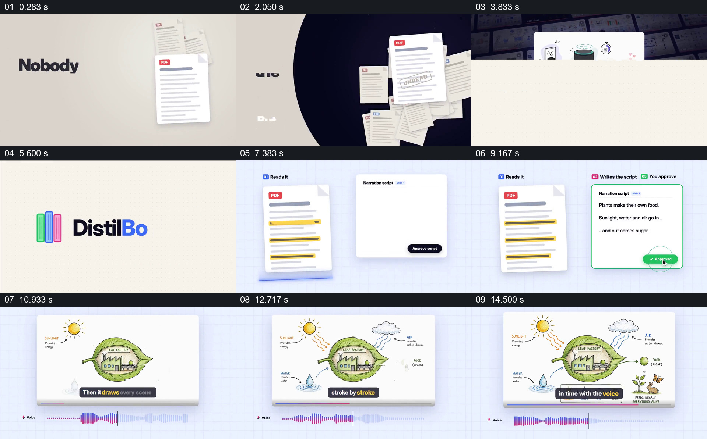

# 从文档转到脚本审批，再展示图解与声音时间线

- 作品：案例 061《文档到图解视频》（索引名称）。
- 原片范围：00:00.000–00:16.000，含起点、不含终点；[完整原片](../video.mp4)｜[本卡片段](c01.mp4)。
- 观察方式：依据整片 64 宫格和约每秒一次的真实源帧观察，未连续原速观看或听审；声音、语气与完整播放节奏未确认。

## 原画面具体怎样设计

叠放的 PDF 页面旁出现“没人读 PDF”的宣传语，随后产品标识出现。页面左侧显示被高亮的 PDF，右侧生成旁白脚本并出现批准状态；接着植物图解逐渐填充，下方显示彩色声音波形与字幕。

## 为什么这样设计，好在哪里

将文档和脚本并置，为审稿提供来源参照；图解和波形接在批准之后，显示内容进入声画制作。无法从静帧证明生成、审批或同步已真实执行。

以上为依据画面的分析，非作者自述；预期观看效果未经观众测试。

## 可直接使用的创意指令

当展示资料转视频的流程时，保留可公开的原始文档与对应脚本，明确由谁核对和批准，再展示同一内容的画面与真实音频时间线；审批和同步状态以实际操作为准。
