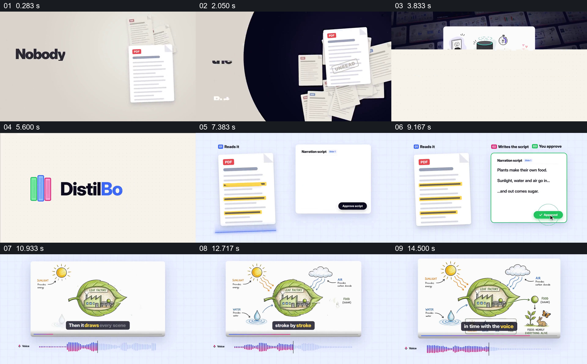

# 原文和脚本并列，审批后让同一内容变成声画

- 作品：案例 061（库内案例）。
- 原片范围：00:00–16.000 秒；[原片](../video.mp4)｜[片段](c01.mp4)。含起点、不含终点。
- 观察方式：查看全片 64 格与本卡九宫格；未独立原速连续观看或听审，审批及产品能力未经验证。 迁移未实测。

## 原画面具体怎样设计

片头浅底堆放 PDF 页面，左侧逐步写出“Nobody reads the PDF”，随后深色背景出现被观看的视频画面，建立文档和视频的对照；产品标识短暂居中。浅蓝网格上，一张 PDF 置于左侧，多个句段以黄色标记；右侧白色卡片写旁白脚本，上方依次标出读取、写稿与用户批准。脚本卡边框和按钮变绿，显示批准状态。

之后页面让位给白色播放器画框：叶子内的“工厂”位于中央，太阳、水滴、云和食物产出分别在四周建立，箭头指出输入输出；画框内下沿是字幕，下方另有彩色语音波形和进度指针。相同的植物主题从脚本被转译成图解。

## 为什么这样设计，好在哪里

左原文、右脚本的并置，使脚本有可回看的来源；批准状态成为从文字阶段转向视觉阶段的清晰节点。植物图解保留脚本中的阳光、水、空气与产物关系，下方波形让声画工作被纳入同一构图。界面动画仅展示了流程概念，不能证明原文准确、用户真实批准或语音同步已经发生。

## 完整照排指令

以[完整原片](../video.mp4)的 0–16 秒为准。画幅 1280×720，源帧率 60/1。以下拍点为抽帧定位，位置按画幅百分比取近似值。

### 源时刻照排

- 0–约 5 秒，浅米底左侧黑粗体【文档开场句】分次建立，重点词白字居红底；右侧层叠【原始文档】。切深色纹理底，中上白色画框播放【视频示例】，下方【视频对照句】末词挂紫色底；随后浅底居中【品牌标识】短停。
- 约 5–10 秒，浅蓝细网格。左半白色 PDF 页面保留同一【原始文档】，给【原文选句】逐行画黄底；右半依次进入白色【脚本卡】并展示【旁白脚本】。两卡上沿由左到右放【流程标记】，确认时右卡细边和底部【批准控件】转绿。
- 约 10–16 秒，脚本界面换成居中的宽白色【图解播放器】，叶片工厂在中部建立；随后日光、水和外部对象由【图解要素】逐步补齐，用箭头说明输入和输出。框内下沿给深底【同步字幕】，框外下方用彩色【语音轨】及竖指针表进度。16 秒转入暗底，第一段播放器结束。

### 用料与取用

【原始文档】【原文选句】【旁白脚本】【图解要素】【同步字幕】【语音轨】须逐层由同一主题和论述派生，提供文件页码及可定位原句、审核后的脚本、分层图和同一录音的时间轴。涉及科学事实给可核对出处。0–约 5 秒的【视频示例】需是可播放且足以展示一次内容变化的原段，可用静态页表达文档，视频窗不循环、不用截图运镜冒充播放。约 5–10 秒文档与脚本原位保持，可用静态界面图层，但黄条与批准状态须按动作建立；【脚本卡】【流程标记】【批准控件】对应真实流程或说明演示性质。约 10–16 秒【图解播放器】持续同段播放，箭头、字幕与语音指针同步，未展完不定格。供短句【文档开场句】【视频对照句】与可用的【品牌标识】。只具备原文与脚本可单用约 5–10 秒；只具备完整图解和对应音文则可单用约 10–16 秒。

### 验证状态

已对照原片约逐秒抽帧与卡稿，核对左右文档与批准状态、同一主题转入图解以及字幕和波形的分层。准确声画同步、原速听看、帧级切点与换料试摆待核。
