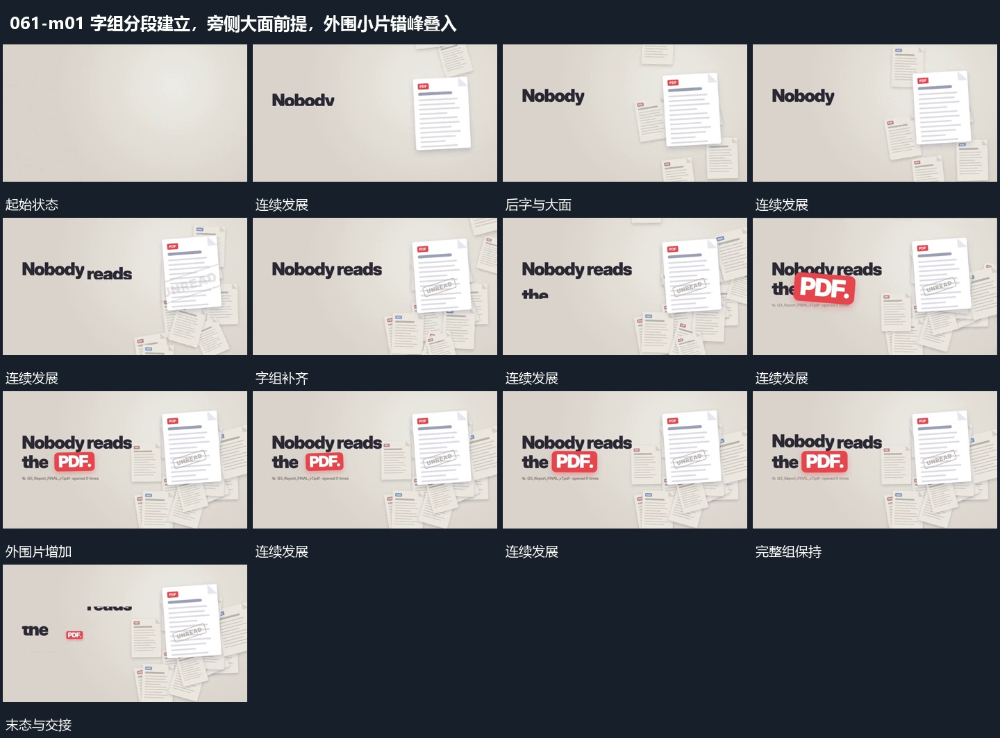

# 字组分段建立，旁侧大面前提，外围小片错峰叠入

## 运动指令

让字组按段增加，在旁侧前提大面，外围小片错峰叠入。大面始终在较前层，后片增加时字组位置保持，最后共同稳定。

## 视频切片

[播放本机制的原片切片](m01.mp4)

覆盖分镜中“首短字”至“完整组保持”的连续过程，并保留邻近的前后衔接画面；原片中交叠发生的动作一并保留。

## 分镜过程

## 组合与调整

材料可换，前后层关系要保留，不把所有片同尺寸同深度一起显示。
