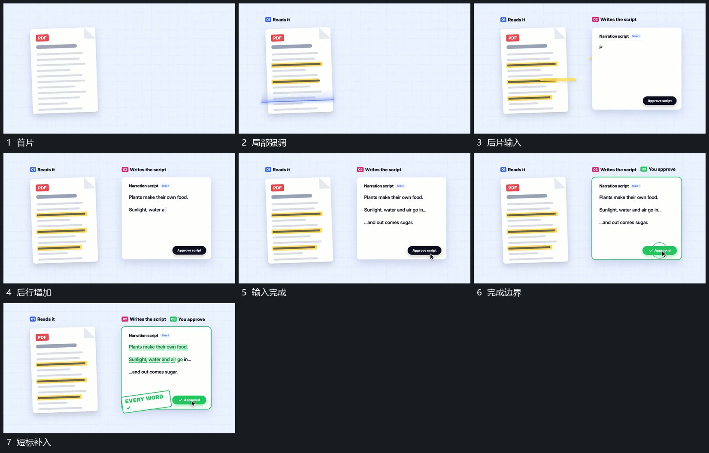

# 并置两片局部强调增加，后片逐行输入后完成反馈

## 运动指令

保留并置两片，在首片中逐项建立局部强调，后片文字逐行输入。输入到完整状态后给后片补完成边界，再追加短标记，首片与前强调保持。

## 视频切片

[播放本机制的原片切片](m03.mp4)

覆盖分镜中“首片”至“短标补入”的连续过程，并保留邻近的前后衔接画面；原片中交叠发生的动作一并保留。

## 分镜过程

## 组合与调整

输入与强调的具体内容可换，完成反馈不能早于内容建立。
