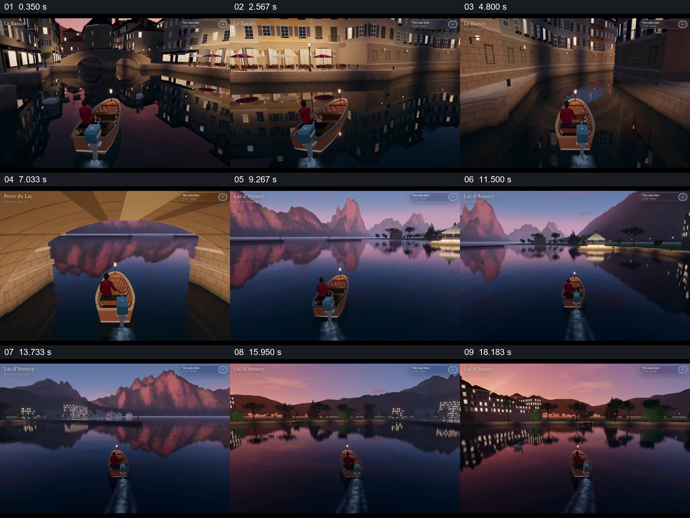

# 跟随小船由狭窄河道进入开阔水面

- 作品：案例 105《小船穿越城市与湖面》（本次概括）。
- 原片范围：00:00.000–00:20.074，含起点、不含终点；[完整原片](../video.mp4)｜[本卡片段](../video.mp4)。
- 观察方式：依据约每秒一次的真实源帧观察，未连续原速观看或听审；声音、语气与完整播放节奏未确认。

## 原画面具体怎样设计

黄昏城市的河道中，小船位于画面下方，周围建筑及灯光倒映在水面；视点从船后跟随其进入石桥洞，洞口逐渐框住远方山景。穿出后画面展开为开阔湖面与山脉，船继续前行并转向，远岸城市和水面倒影逐渐进入视野。

## 为什么这样设计，好在哪里

桥洞先限制视野，出口中的山景提前提示新的空间；穿出后保留同一小船和水面，使开阔感来自可辨的前后对照。画面为虚拟场景演示，未核验实景地点。

以上为依据画面的分析，非作者自述；预期观看效果未经观众测试。

## 可直接使用的创意指令

设计空间探索时，用一个可持续追踪的交通工具或人物建立观察位置；通过狭窄通道时在出口预露下一空间，再保持运动方向进入开阔景观，最后用远岸或地标交代去向。环境和路径依据素材设计。
