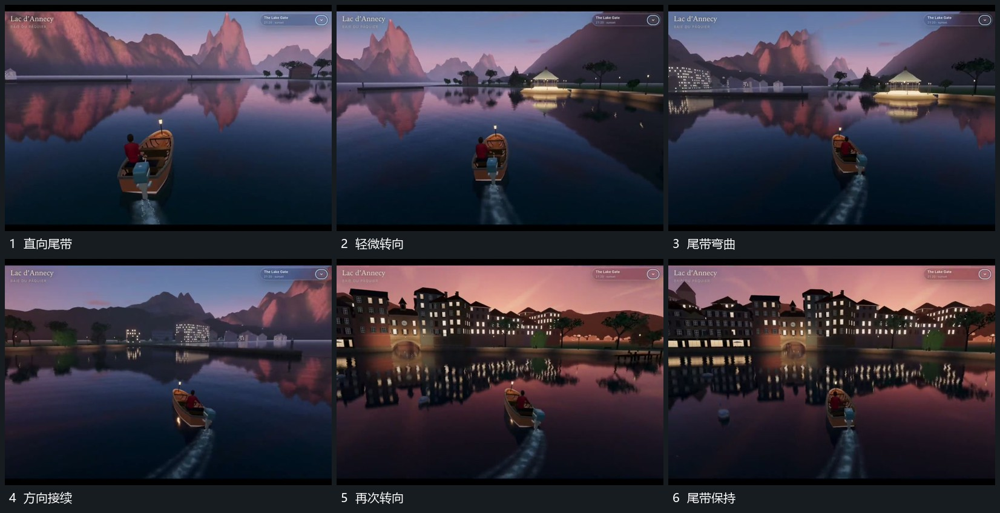

# 移动主组身后留下短带转向时尾带弯曲

## 运动指令

主组向前移动时从身后持续留下短带，离主组越远的部分逐步退弱。主组转向后新带沿新方向接上，旧带暂时保留，形成连续弯曲路线；尾带不拉着主组回到旧方向。

## 视频切片

[播放本机制的原片切片](m03.mp4)

覆盖分镜中“直向尾带”至“尾带保持”的连续过程，并保留邻近的前后衔接画面；原片中交叠发生的动作一并保留。

## 分镜过程

## 组合与调整

可用点列或薄片尾迹；只借鉴路径记忆，不需要流体算法。
