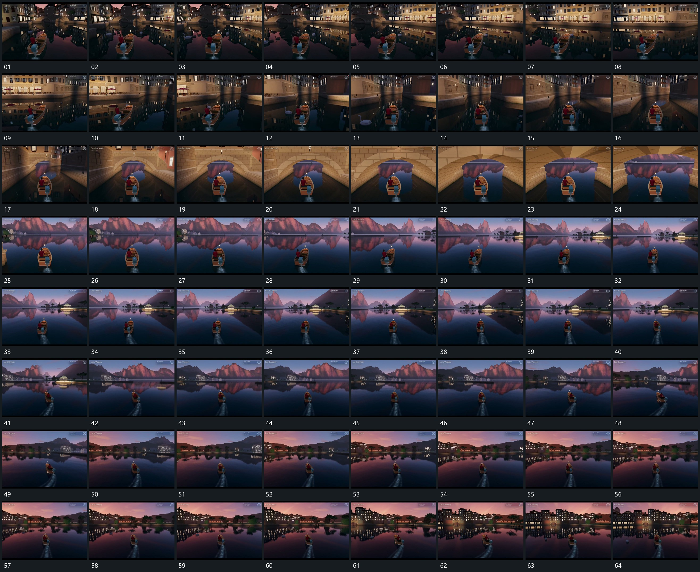

# 105｜原片运动总览

[观看完整原片](video.mp4)

## 运动总览

全片围同一移动主组，从后方跟随主组沿弯道改变方向并逐步退远持续从后方跟随并沿弯道改变方向。经过窄范围时对准开口穿过近侧遮挡后露出宽空间对准开口，先进入遮挡范围再露出更宽空间。进入开阔范围后继续复用从后方跟随主组沿弯道改变方向并逐步退远，取景逐步后退并转向侧后方。

主组身后移动主组身后留下短带转向时尾带弯曲留下连续短带，路线转向时尾带随之弯曲并逐步退弱。后半段重复沿弯道跟随，最终回到开口附近，全部运动保持同一主体来源。

## 完整运动段落

以下按原片中的出现顺序引用。建立、内部发展及完成反馈放在同一段中；同时发生的局部动作与运镜写在同一份指令里。不同段之间可以是连续接管，也可以是直接切换，不能仅凭条目相邻认定可直接拼接。重复出现的同类运动采用一次连续代表范围，切片不以逐段无缝覆盖整片为目标。

1. [跟随主组转弯穿过遮挡，尾带延续路径并在退镜中展开空间](mechanisms/m04.md)：取景从后方跟随主组沿弯曲路径移动；穿过近侧开口后空间变宽，主组继续转向，身后短带随路径弯曲；取景逐渐退远显示整体行进关系。

切片保留起始准备、必要内部停顿和完成或明确交接；首尾省略无新发展的等待，持续运动不要求人为停住。以上基于真实源帧序列和重点边界核对，不等同于全片连续声画审片。

## 完整64宫格

