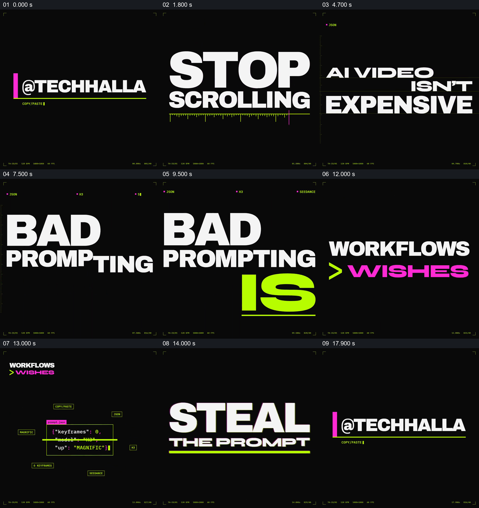

# 把一组相互接续的观点排成动态海报，并落到行动提示

- 作品：案例 119《荧光色动态文字海报》（索引名称）。
- 原片范围：00:00.000–00:18.200，含起点、不含终点；[完整原片](../video.mp4)｜[本卡完整片段](c01.mp4)。片尾剩余时间继续保持已建立的账号标识，未纳入本卡。
- 观察方式：按原片 64 宫格和约每秒一次的原片抽帧观察整片，另核看下方九个源帧；未连续原速观看。原片有音轨，但解码后的采样全为零；未进行听审。

## 原画面具体怎样设计

黑底先出现 `@TECHHALLA` 标识和细绿线，接着巨大的 STOP 与 SCROLLING 依次建立，下方有带刻度的荧光绿线。新一组白字显出“AI VIDEO ISN'T EXPENSIVE”；其中末尾文字在转换过程中出现快速变化的荧光字符，然后画面转为“BAD PROMPTING IS”，用醒目的绿色 IS 回应前一句。

随后大字换成“WORKFLOWS > WISHES”，其中比较符号是绿色，WISHES 是粉色。比较句缩到左上，中央出现一张小型代码样式卡片及周围标签；卡片退去后，“STEAL THE PROMPT”以大字和绿线占据中心。最后粉色竖条与账号文字重新建立，绿线和较小的 COPY/PASTE 字样补齐。

## 为什么这样设计，好在哪里

两句“AI VIDEO ISN'T EXPENSIVE”和“BAD PROMPTING IS”先后出现，后一组的 IS 承接前句中的判断，使观众需要把相邻两屏连起来理解。接着用明显的比较符号将 WORKFLOWS 和 WISHES 排在一起，再把这组观点缩到角落，为中间的提示词示意和行动口号让出空间；主张、例子和行动因此有清楚的先后关系。

文字本身是片中的宣传观点，不是对 AI 视频成本或提示词效果的独立事实判断。小代码卡片是画面示意，不能据此认定它是可运行、可复制的完整提示词。以上是作品分析，不代表作者自述或已测量的观众反应。

## 可直接使用的创意指令

当内容能够准确压缩为少量彼此有关的短判断，而且需要引向一项清楚的行动时，先按实际论证关系排列句子：让第一句话形成可读的前提，再让下一句补足、修正或对照它。用尺寸和颜色区分主要词、比较关系与次要信息，在每个判断成立后再交给下一组文字；需要展示例子时，可把已完成的观点缩到一侧，让中央区域呈现与观点有关的真实材料或明确标注的示意。最后以准确的行动句和可用入口收束，并留足阅读时间。文字、颜色、动效与账号形式可按新任务调整；不要用视觉对比代替事实依据，也不要把装饰性的代码或按钮当作可执行内容。
