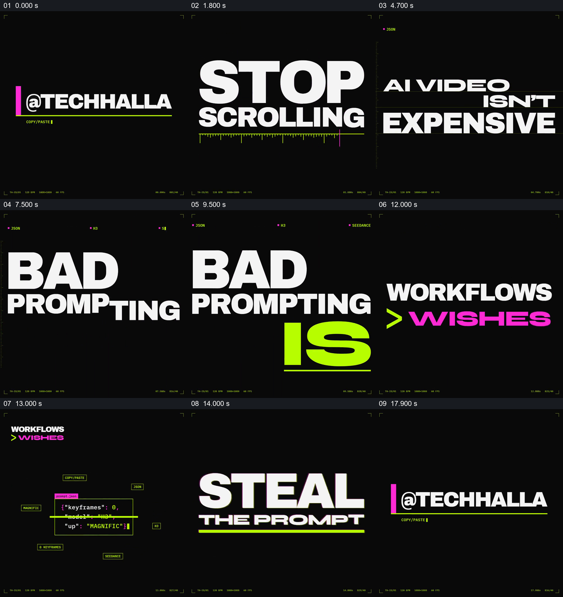

# 让相互接续的观点成为一组动态海报

- 作品：案例 119。
- 原片范围：00:00.000–00:18.200（源时间，含起点、不含终点）；[完整原片](../video.mp4)｜[本卡片段](c01.mp4)。复用同范围片段和分镜。
- 观察方式与未确认范围：核看全片 64 帧总览和本卡九宫格；历史检测显示音轨解码采样为零；未独立连续原速观看或听审，抽帧间运动、精确节奏及同步未确认。价值判断为作品分析，跨项目迁移尚未实测。

## 原画面具体怎样设计

黑色方形画面上，白色账号名旁有粉色竖条，下方一条荧光绿线；随后画面中央依次建立巨大的“STOP / SCROLLING”，下方保留带刻度的绿线。文字覆盖大部分画面，其他信息退到边缘。

接着白字“AI VIDEO ISN’T EXPENSIVE”分行构成新的主张，部分字母在不同抽帧呈现荧光字符或未完成状态；下一幅画面改为“BAD PROMPTING IS”，其中绿色的 IS 远大于周围小字，承接上一句。再之后“WORKFLOWS > WISHES”出现，比较符号为绿、WISHES 为粉。

这句比较缩到左上角后，中央出现一张提示词或代码样式的深色小卡，四周散放小标签；它离开后，“STEAL THE PROMPT”变成新的大字，并有绿线强调。最后账号名、粉色竖条与绿线回到画面，构成行动后的身份出口。本卡结束于账号形成后的停留，原片其后仍有品牌尾屏。

## 为什么这样设计，好在哪里

每一句主张都使用占据画面的大字，让读者一次只面对一个信息；绿色词语、线与粉色强调把相邻观点视觉上关联起来。将“WORKFLOWS > WISHES”缩到角落时，中央才腾出空间展示一个看似提示词的具体对象；最后行动句和账号顺序出现，使观点落到下一步。

这是对画面编排的分析；片中关于费用和提示词的结论是宣传主张，本卡不核实其普遍性。

## 可直接使用的创意指令

当内容有一条主张、一个有意义的对比和明确行动时，将每一小句写成能独立读懂的短句，依次给它们完整的画面空间。用少量一致的颜色或线条标记前后关系；需要展示具体示例时，把前一观点缩到固定角落作为上下文，让示例获得主位置，再交给行动提示和来源身份。

字体、颜色、画幅和动效可调整；需要保留观点的逻辑顺序、示例与观点的联系及明确的行动出口。涉及事实或价格的说法须核实，文字多时应留足阅读时间。
