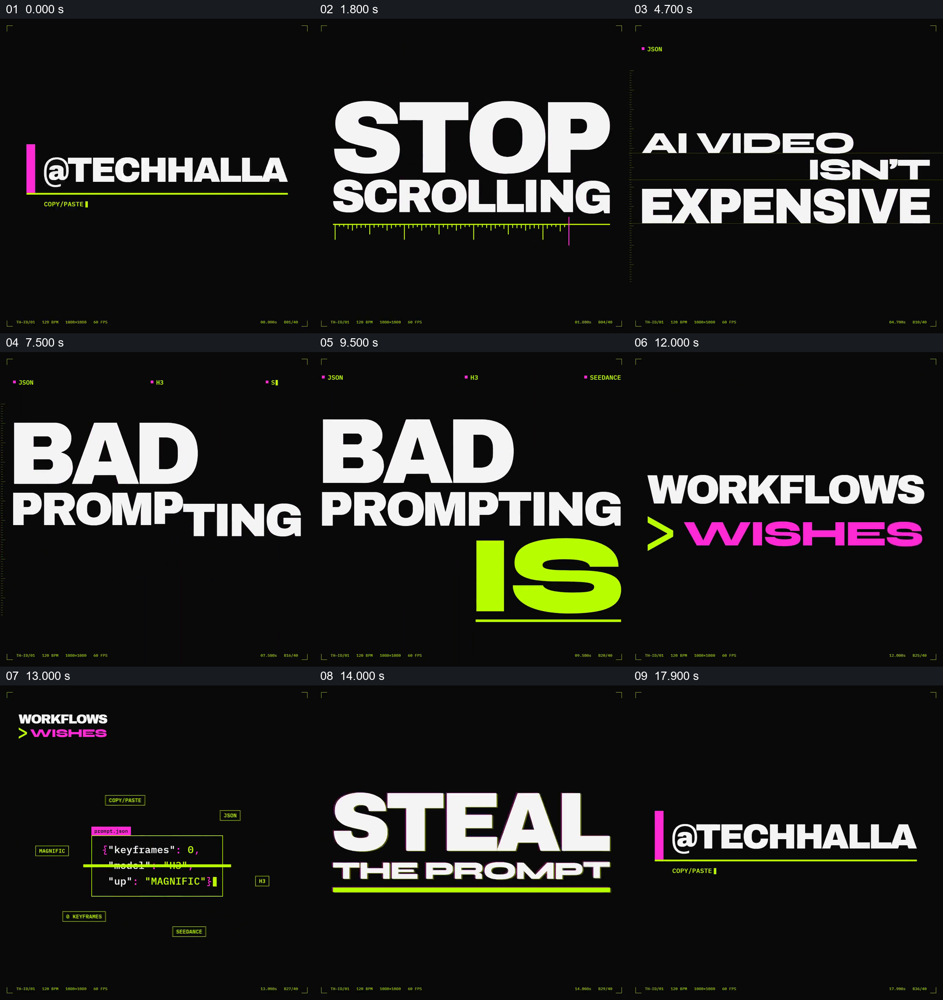

# 让相互接续的观点成为一组动态海报

- 作品：案例 119。
- 原片范围：00:00.000–00:18.200（源时间，含起点、不含终点）；[完整原片](../video.mp4)｜[本卡片段](c01.mp4)。复用同范围片段和分镜。
- 观察方式与未确认范围：核看全片 64 帧总览和本卡九宫格；历史检测显示音轨解码采样为零；未独立连续原速观看或听审，抽帧间运动、精确节奏及同步未确认。价值判断为作品分析，跨项目迁移尚未实测。

## 原画面具体怎样设计

黑色方形画面上，白色账号名旁有粉色竖条，下方一条荧光绿线；随后画面中央依次建立巨大的“STOP / SCROLLING”，下方保留带刻度的绿线。文字覆盖大部分画面，其他信息退到边缘。

接着白字“AI VIDEO ISN’T EXPENSIVE”分行构成新的主张，部分字母在不同抽帧呈现荧光字符或未完成状态；下一幅画面改为“BAD PROMPTING IS”，其中绿色的 IS 远大于周围小字，承接上一句。再之后“WORKFLOWS > WISHES”出现，比较符号为绿、WISHES 为粉。

这句比较缩到左上角后，中央出现一张提示词或代码样式的深色小卡，四周散放小标签；它离开后，“STEAL THE PROMPT”变成新的大字，并有绿线强调。最后账号名、粉色竖条与绿线回到画面，构成行动后的身份出口。本卡结束于账号形成后的停留，原片其后仍有品牌尾屏。

## 为什么这样设计，好在哪里

每一句主张都使用占据画面的大字，让读者一次只面对一个信息；绿色词语、线与粉色强调把相邻观点视觉上关联起来。将“WORKFLOWS > WISHES”缩到角落时，中央才腾出空间展示一个看似提示词的具体对象；最后行动句和账号顺序出现，使观点落到下一步。

这是对画面编排的分析；片中关于费用和提示词的结论是宣传主张，本卡不核实其普遍性。

## 完整照排指令

以[完整原片](../video.mp4)的 0–18.2 秒为准。画幅 1080×1080，源帧率 60/1。以下拍点为抽帧定位，位置按画幅百分比取近似值。

### 源时刻照排

- 0–约 3 秒，黑色方幅，白色【账号名】在粉色竖条与荧绿细线之间短暂建立，随即以超粗白体【拦停主句】分成上下两行，几乎满宽。下沿保留带小刻度的绿线，边角小标低亮。
- 约 3–10 秒，在同一字宽内由【第一主张】接管，白字按短行补齐，荧绿短字符和错位只用于过门；接【反转主张】，白字放上方，绿色重点字放大到接近一行宽，短下划线留在底部。
- 约 10–14 秒，放【比较句】，比较符号为绿、末词粉，稳定后缩到左上。中央建立深色【示例卡】，用小号等宽【示例原文】和绿框，周围散放【字段标签】而不遮住卡。
- 约 14–18.2 秒，卡退出，白色【行动句】重新占据中心，第二行下方用绿线标记。随后账号重入，粉色竖条在左、绿线在下，保持到本卡结束，后续独立品牌尾屏不纳入。

### 用料与取用

【账号名】用于片头、片尾，供一致拼写及实际归属；【拦停主句】【第一主张】【反转主张】【比较句】【行动句】给可拆行短文，反转须能直接承接上句，行动要指向画内示例。【示例卡】【示例原文】【字段标签】供同一可公开示例的实际内容，若有成本或效率数字需可核对出处和口径，宣传语按项目事实定稿。比较句自约 10 秒全幅建立并缩至 14 秒示例结束前维持，静态样例可分层；文字及卡片只做一次进出，不循环闪动或用照片运镜代替字位切换。仅有文案可取约 0–10 秒排字，只有实际示例可独立取约 10–14 秒，省去无支撑的成本主张。

### 验证状态

已核对原片等距抽帧与卡稿，检查白字到荧绿反转、比较句缩角、卡片与账号收尾。切点、原速听看和换料试摆待核。
