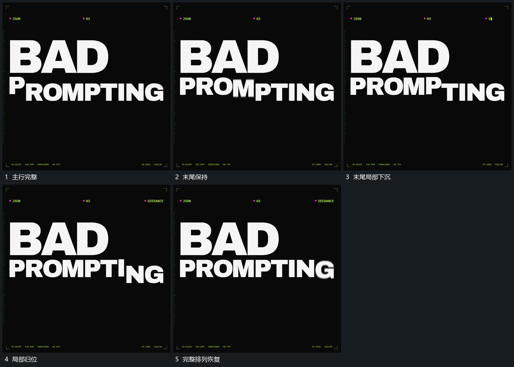

# 主行末尾局部先下沉再回到原基线

## 运动指令

保持主行大部分位置，末尾少量片向下偏离共同基线，邻近片仍保留参照。偏离片错开回到原位，恢复完整排列后保持；不要让整个主行同时上下移动。

## 视频切片

[播放本机制的原片切片](m04.mp4)

覆盖分镜中“主行完整”至“完整排列恢复”的连续过程，并保留邻近的前后衔接画面；原片中交叠发生的动作一并保留。

## 分镜过程

## 组合与调整

只需少量片即可；局部偏移属于同一排列中的动作，不能在下沉时替换成另一份主体。
