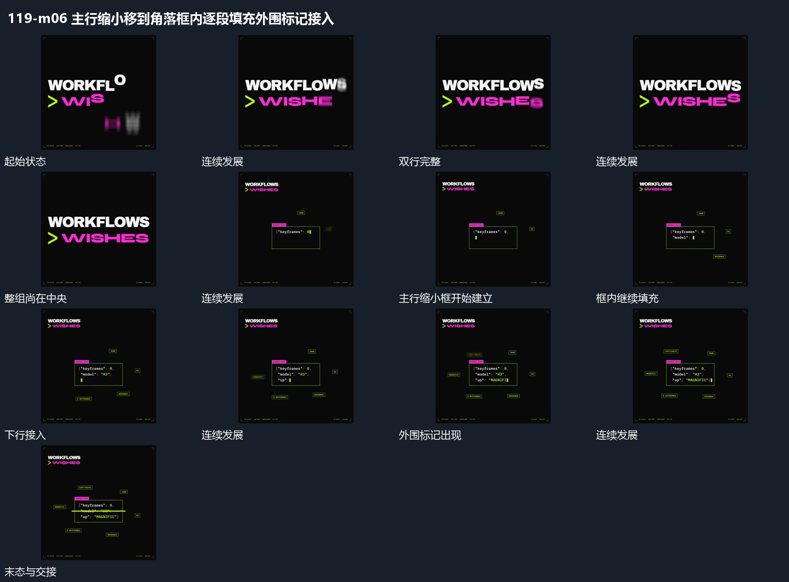

# 主行缩小移到角落框内逐段填充外围标记接入

## 运动指令

将完整双行一起缩小并移到角落，腾出的范围建立一个框。框内从上向下逐段填入短行，已填部分保持，末端小标记跟随新增片前进；外围标记错开接入，最后横线扫过框内局部，主行仍在角落保持。

## 视频切片

[播放本机制的原片切片](m06.mp4)

保留起始准备、连续发展和完成或明确交接；首尾按本段运动范围裁切，不拼接、不变速。尾部只保留理解结果所需的展示。

## 分镜过程

## 组合与调整

框内可换成任意短项；不复制原程序文字，保留旧主行退让、新框累计和外围信息后接的层级关系。
