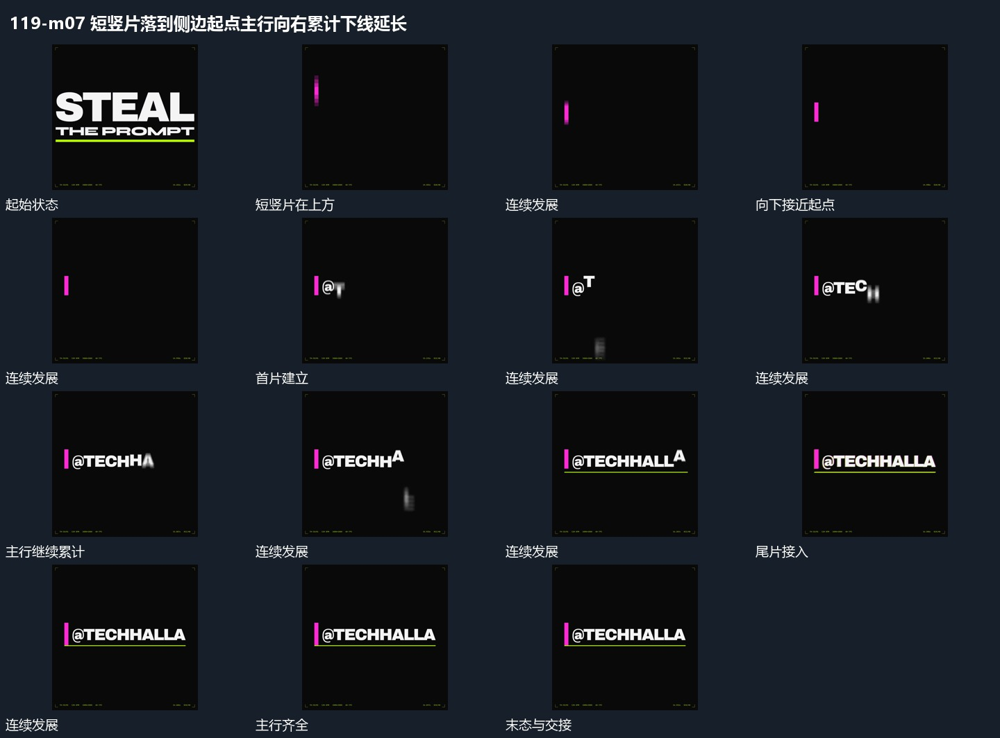

# 短竖片落到侧边起点主行向右累计下线延长

## 运动指令

短竖片从上方向下移动到主行左侧起点，落位后保持。字片从这个接点向右错开进入，先到片保持，尾片仍在经过；主行齐全后下线向右延长，下方短附属行随后累计，最后整体保持。

## 视频切片

[播放本机制的原片切片](m07.mp4)

覆盖分镜中“短竖片在上方”至“共同保持”的连续过程，并保留邻近的前后衔接画面；原片中交叠发生的动作一并保留。

## 分镜过程

## 组合与调整

侧边标记可以换成点或框角；接点必须先建立并持续留下，不让标记在每片出现时重新跳位。
