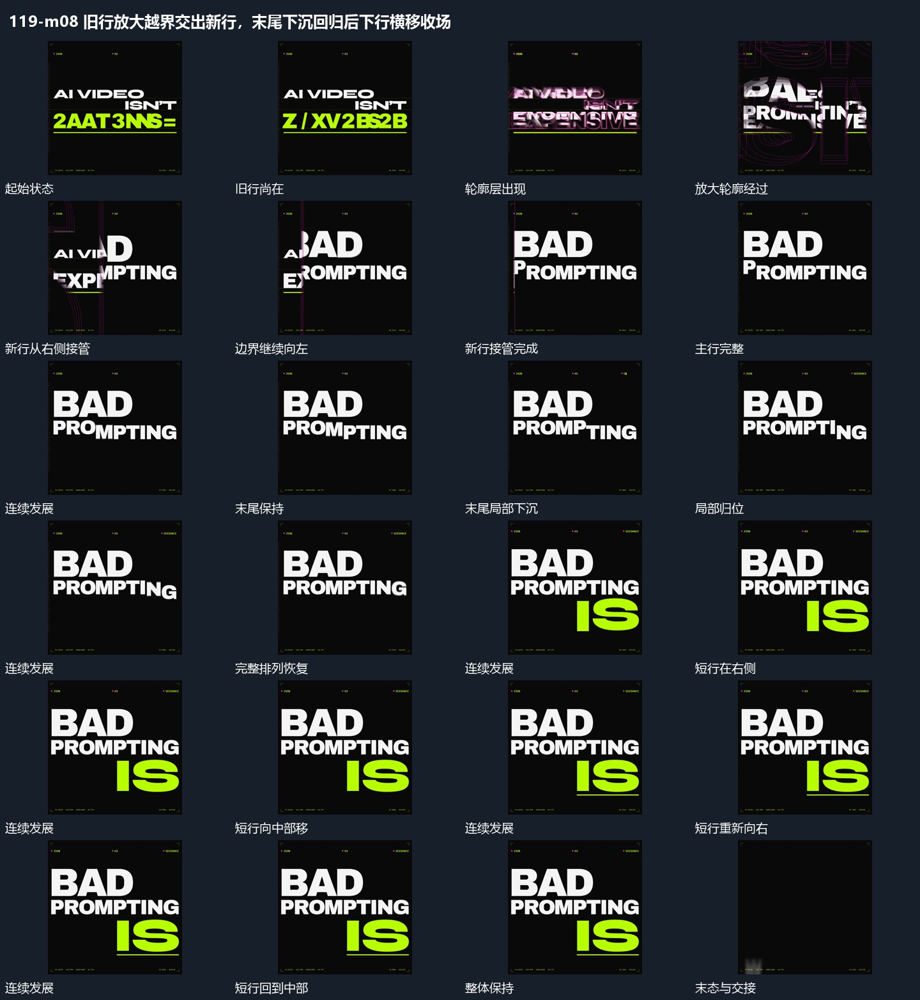

# 旧行放大越界交出新行，末尾下沉回归后下行横移收场

## 运动指令

旧行轮廓放大越界，新行从侧方接管；末尾局部先下沉再回到原基线，下方短行接入后与下线共同横移，上行保持，最后退场。

1. **旧行轮廓放大经过前景边界从右向左接管新行**

先从旧行叠出多层轮廓并放大，使轮廓经过前景而旧行仍可辨。随后用从右向左推进的边界逐步显露新行，边界另一侧保留旧行，直到旧行全部退出；新行不在交接中反复重新入场。

2. **主行末尾局部先下沉再回到原基线**

保持主行大部分位置，末尾少量片向下偏离共同基线，邻近片仍保留参照。偏离片错开回到原位，恢复完整排列后保持；不要让整个主行同时上下移动。

3. **下方短行与下线共同横移上方保持**

上方主行保持，下方短行横向移到另一位置，下线跟随短行共同移动并维持间距。移位时保留短行自身排列，不重新逐片入场；到位后留出保持，再按需要反向移回。

整段结束：下方短行在另一侧保持 保留必要落稳与交接，中间已建立的参照沿用到下一步骤。

## 视频切片

[播放本机制的原片切片](m08.mp4)

保留起始准备、连续发展和完成或明确交接；首尾按本段运动范围裁切，不拼接、不变速。相连的小动作合为同一完整段落。

## 分镜过程

## 组合与调整

旧行轮廓放大越界，新行从侧方接管；末尾局部先下沉再回到原基线，下方短行接入后与下线共同横移，上行保持，最后退场。 复用时可调整元素数量、幅度和相对节奏，保留上述进入、交叠与完成关系；不直接沿用原片题材或时长。

轮廓层数可减少；保留旧新共存的中途和统一边界，不将放大与清屏当成两个无关特效。

只需少量片即可；局部偏移属于同一排列中的动作，不能在下沉时替换成另一份主体。

位置与移位次数可改；同一条下线不能停留在旧位置，保持上下关系的参照仍可见。
