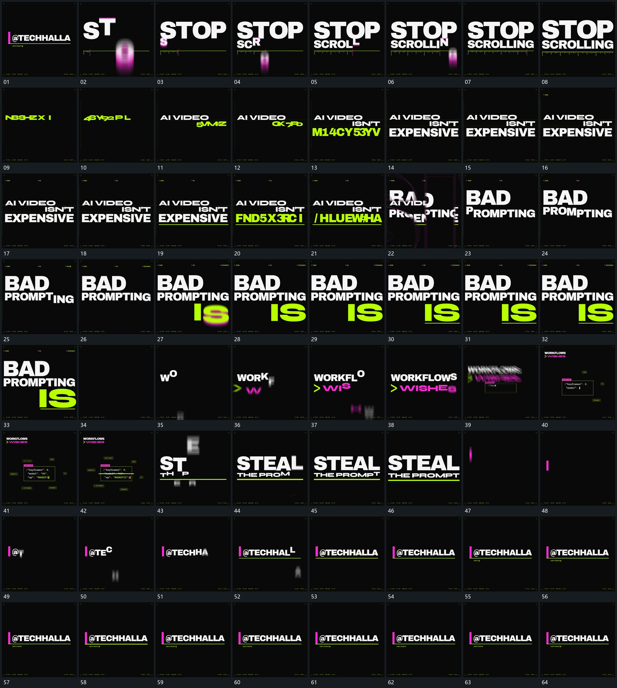

# 119｜原片运动总览

[观看完整原片](video.mp4)

## 运动总览

开头的短行直接切到大行，字片错开沿竖向进入落稳后下线延长让字片错开从竖向进入，落稳后下方细线和小刻度沿横向建立。下一组排列以固定行位内快速换片逐行收定在固定行位中快速换片并逐步收定，先到位的行保持，后行继续建立。

旧行轮廓放大经过前景边界从右向左接管新行先将旧行的轮廓放大经过前景，再以从右向左推进的边界接管为新行。新行内部主行末尾局部先下沉再回到原基线让末尾局部下沉后回到原位，下方短行复用字片错开沿竖向进入落稳后下线延长建立，再用下方短行与下线共同横移上方保持与下线共同横移。

之后一组双行复用字片错开沿竖向进入落稳后下线延长进入，主行缩小移到角落框内逐段填充外围标记接入将其缩小移到角落，下方框内逐段填充，外围标记接入；横线扫过框内后切回大行，再次复用字片错开沿竖向进入落稳后下线延长。末段短竖片落到侧边起点主行向右累计下线延长让短竖片从上方落到左侧起点，主行从这个接点向右逐片累计，下线延长，最后共同保持。

## 完整运动段落

以下按原片中的出现顺序引用。建立、内部发展及完成反馈放在同一段中；同时发生的局部动作与运镜写在同一份指令里。不同段之间可以是连续接管，也可以是直接切换，不能仅凭条目相邻认定可直接拼接。重复出现的同类运动采用一次连续代表范围，切片不以逐段无缝覆盖整片为目标。

1. [字片错开沿竖向进入落稳后下线延长](mechanisms/m01.md)：竖向进入错开落稳

2. [固定行位内快速换片逐行收定](mechanisms/m02.md)：局部换片收定后续行建立

3. [旧行放大越界交出新行，末尾下沉回归后下行横移收场](mechanisms/m08.md)：旧行轮廓放大越界，新行从侧方接管；末尾局部先下沉再回到原基线，下方短行接入后与下线共同横移，上行保持，最后退场。

4. [主行缩小移到角落框内逐段填充外围标记接入](mechanisms/m06.md)：主行退让框内累计

5. [短竖片落到侧边起点主行向右累计下线延长](mechanisms/m07.md)：标记落位后逐片建立

切片保留起始准备、必要内部停顿和完成或明确交接；首尾省略无新发展的等待，持续运动不要求人为停住。以上基于真实源帧序列和重点边界核对，不等同于全片连续声画审片。

## 完整64宫格

