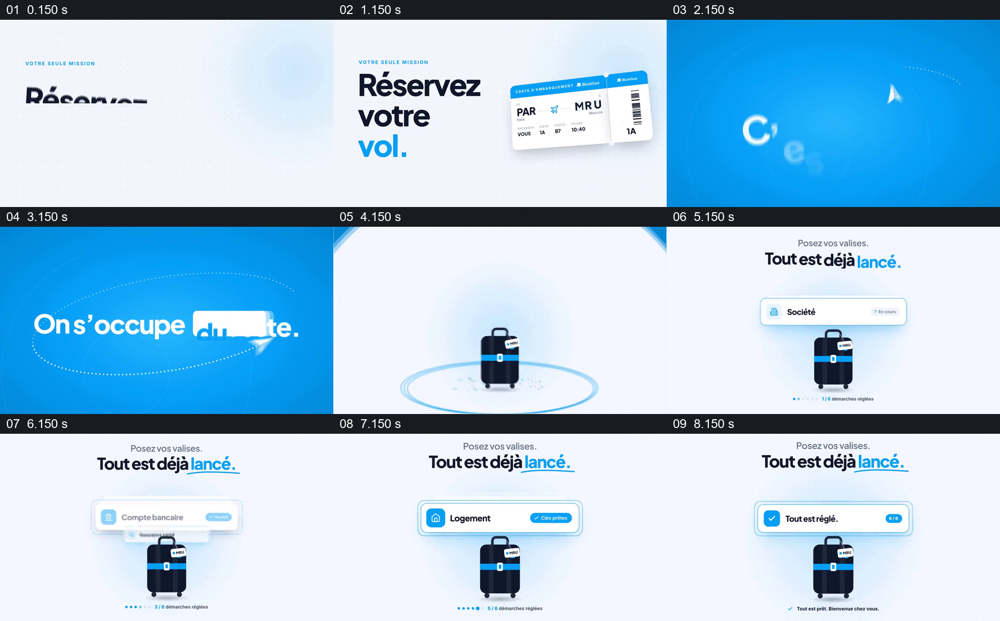

# 用机票与行李箱分工，逐项显示后续事项

- 作品：案例 015《旅行影像与品牌排版》（索引名称）。
- 原片范围：00:00.000–00:09.000，含起点、不含终点；[完整原片](../video.mp4)｜[本卡片段](c01.mp4)。
- 观察方式：依据整片 64 宫格和约每秒一次的真实源帧观察，未连续原速观看或听审；声音、语气与完整播放节奏未确认。

## 原画面具体怎样设计

白底先出现订机票文字与登机牌；蓝色画面中纸飞机路径和短句说明其余事项由服务方处理。接着浅色画面以行李箱为中心，上方卡片依次显示公司、银行账户、住房等事项，末尾呈现带勾的完成提示。

## 为什么这样设计，好在哪里

机票和行李箱都是与旅行直接相关的物件，前者对应用户的动作，后者保持在后续事项下方，把不同任务收在同一情境。逐项替换状态比只展示一个总承诺更容易理解所涉及的类别；这些状态并非已核实的订单记录。

以上为依据画面的分析，非作者自述；预期观看效果未经观众测试。

## 可直接使用的创意指令

当要说明用户只需完成一部分工作、其他步骤由服务方处理时，先明确可核实的责任分工，用与用户动作有关的物件建立场景；再固定一个能代表整个旅程的主体，把服务事项逐项放在其附近，区分待处理和已完成，最后保留总状态。只展示实际承诺的项目与条件，示意勾号不证明具体订单已经完成。
