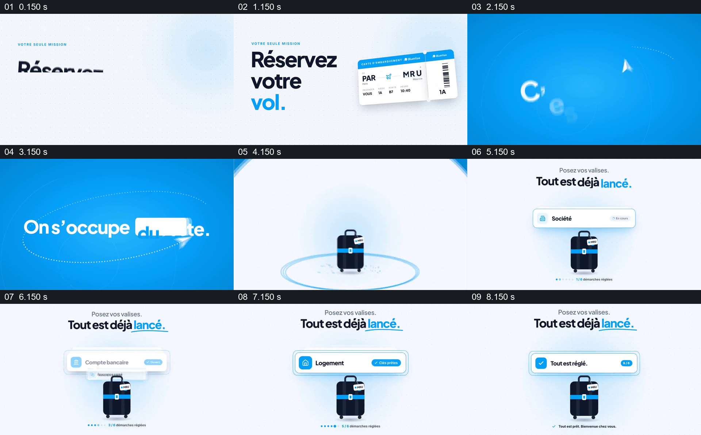

# 用机票明确顾客责任，再让行李上方轮换服务状态

- 作品：案例 015《旅行影像与品牌排版》（库内索引名）。
- 原片范围：00:00.000–00:09.000，含起点、不含终点；[完整原片](../video.mp4)｜[本卡片段](c01.mp4)，片段起点对应原片 0.000 秒。
- 范围依据：机票、责任交接与六项服务状态共同形成一个流程，完成后切到目的地画面。
- 观察方式：核看全片 64 帧总览及本卡九宫格；未独立连续原速观看，快速变化和运动节奏待核。未独立听审，声音内容未知。片中事实和演示未独立查证，新题材迁移尚未实测。

## 原画面具体怎样设计

白底左侧大字“Réservez votre vol.”，右侧是一张目的地代码变换的登机牌，随后盖上“RÉSERVÉ”章。蓝色圆形与纸飞机图形接管画面，中心文字由“C’est tout”转为“On s’occupe du reste”。白底行李箱出现在中心，上方条目依次显示居留、公司、银行、保险、住宿、家庭签证等状态；底部进度从 1/6 增至 6/6，最后留下“Tout est réglé”。

## 为什么这样设计，好在哪里

前段把用户动作压缩到一张机票，蓝色承诺页完成责任交接；行李箱始终在下方，上方变化的条目提供其他工作正在办理的视觉实例。若只有“我们负责剩下的”，观众看不到剩余事项是什么；模拟进度不能证明这些手续已经办理。

## 可直接使用的创意指令

先用一个具体对象和简短文字展示用户实际需要完成的动作，再明确服务方接手范围。让一个与用户旅程相关的对象持续作为参照，在其附近逐项展示可核实的服务与进度，最后形成清楚结果。对象、步骤数和美术可以改变；不要把模拟状态当作真实申请结果。
