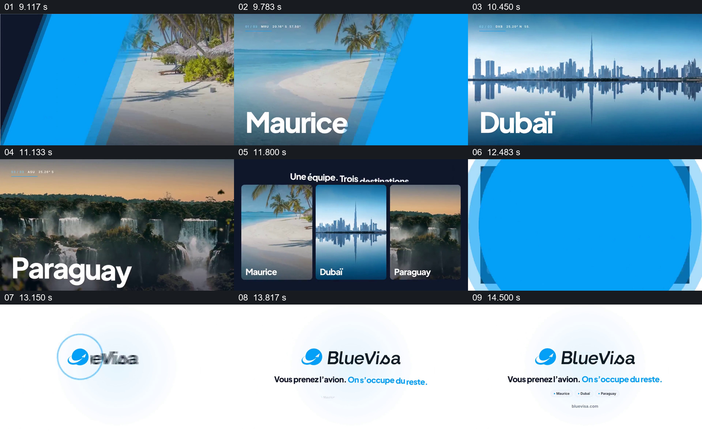

# 先展示三个目的地，再将它们并排收进品牌结尾

- 作品：案例 015《旅行影像与品牌排版》（库内索引名）。
- 原片范围：00:09.000–00:15.061，含起点、不含终点；[完整原片](../video.mp4)｜[本卡片段](c02.mp4)，片段起点对应原片 9.000 秒。
- 范围依据：从三个地点的独立画面到集合与品牌共同完成服务范围展示。
- 观察方式：核看全片 64 帧总览及本卡九宫格；未独立连续原速观看，快速变化和运动节奏待核。未独立听审，声音内容未知。片中事实和演示未独立查证，新题材迁移尚未实测。

## 原画面具体怎样设计

海滩、城市天际线和瀑布影像依次成为全屏背景，左下分别出现 Maurice、Dubaï、Paraguay；蓝色斜向图形位于交界处。之后三处画面缩为深蓝底上的三张竖向并列卡，上方写“Une équipe. Trois destinations.”。蓝色圆形覆盖并交出白底 BlueVisa 标识，下面的文字重述乘飞机与服务分工，并列三个地点标签。

## 为什么这样设计，好在哪里

每个地点先有自己的全屏观察机会，再在同一画面里归入一组；地点名称与实际画面同时出现，最后品牌页通过重复目的地标签延续集合。如果只显示三个名称，地点差异较难直接感知。画面不能独立确认服务范围或地点素材来源。

## 可直接使用的创意指令

为每个真实地点准备可辨认的视觉素材及准确名称，让它们先独立建立，再以相近尺寸并列，使观众既看见差别也理解它们属于同一范围。最后以品牌或共同任务承接，保留地点与承诺的对应。地点数量、过渡和卡片造型可改；不要误用无法核实的地点素材。
