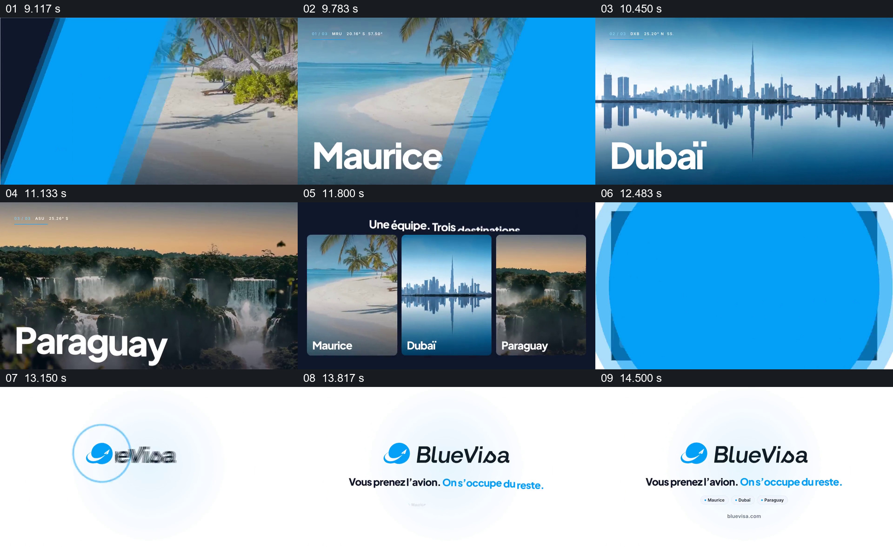

# 先展示三个目的地，再将它们并排收进品牌结尾

- 作品：案例 015《旅行影像与品牌排版》（库内索引名）。
- 原片范围：00:09.000–00:15.061，含起点、不含终点；[完整原片](../video.mp4)｜[本卡片段](c02.mp4)，片段起点对应原片 9.000 秒。
- 范围依据：从三个地点的独立画面到集合与品牌共同完成服务范围展示。
- 观察方式：核看全片 64 帧总览及本卡九宫格；未独立连续原速观看，快速变化和运动节奏待核。未独立听审，声音内容未知。片中事实和演示未独立查证，新题材迁移尚未实测。

## 原画面具体怎样设计

海滩、城市天际线和瀑布影像依次成为全屏背景，左下分别出现 Maurice、Dubaï、Paraguay；蓝色斜向图形位于交界处。之后三处画面缩为深蓝底上的三张竖向并列卡，上方写“Une équipe. Trois destinations.”。蓝色圆形覆盖并交出白底 BlueVisa 标识，下面的文字重述乘飞机与服务分工，并列三个地点标签。

## 为什么这样设计，好在哪里

每个地点先有自己的全屏观察机会，再在同一画面里归入一组；地点名称与实际画面同时出现，最后品牌页通过重复目的地标签延续集合。如果只显示三个名称，地点差异较难直接感知。画面不能独立确认服务范围或地点素材来源。

## 完整照排指令

以[完整原片](../video.mp4)的 9–15.061 秒为准。画幅 1280×720，源帧率 60/1。以下拍点为抽帧定位，位置按画幅百分比取近似值。

### 用料

【海岸镜头】【城市镜头】【瀑布镜头】分别取真实目的地的动态远景，构图应同时可用于满幅及三列竖裁。准备与画面匹配的【地名一】【地名二】【地名三】及【合组标题】【品牌标志】【品牌句】【片尾小注】。涉及真实服务范围时附可打开的地域与服务说明。

### 按源时刻摆放

1. **9.000–约 10.000 秒。** 【海岸镜头】满铺，海线从左入，白沙偏右，树叶在右上近层。左下大白粗【地名一】，同边留距。极小浅字在画顶，不抢阅读。
2. **约 10.000–11.500 秒。** 用亮蓝斜边短过门换【城市镜头】，蓝天、天际线及水中倒影占满幅，左下同字号【地名二】。再换【瀑布镜头】，保留落水、暗绿岸及暖灰天空，白粗【地名三】落在下缘空位。每个镜头自入场至过门完整播放，不用冻结或循环作为实景动作。
3. **约 11.500–12.700 秒。** 深蓝背景中把同一批实景分别裁成三个等宽竖卡，在 x4%–96% 并列，同上底线和窄暗缝。每卡左下留对应【地名一】【地名二】【地名三】，比满幅字号小；顶上居中添白色【合组标题】，一行细粗字。三窗从出现到整体退场同留。采用动态时用各已见镜头的连续可用源段，保持辨认特征；仅作范围小结时允许从三条镜头各抽一帧定格。
4. **约 12.700–15.061 秒。** 深色三窗全退，白底中央先建立小亮蓝圆，再展开成【品牌标志】。下方以一行深色加青色强调排【品牌句】，补小【片尾小注】。保留中轴与大片留白，至片尾切出。

### 局部采用

三个真实地点齐全可取约 9–12.700 秒。只有三张同源静照可取约 11.500–12.700 秒的并列方案，不沿用前面的动态实景段。

### 验证状态

已对照每秒两帧原片画序并读回，核对三地依次满幅、同源裁切三列、蓝圆至品牌结尾。斜边与切点精确帧、三窗相位和换料试摆待核。
