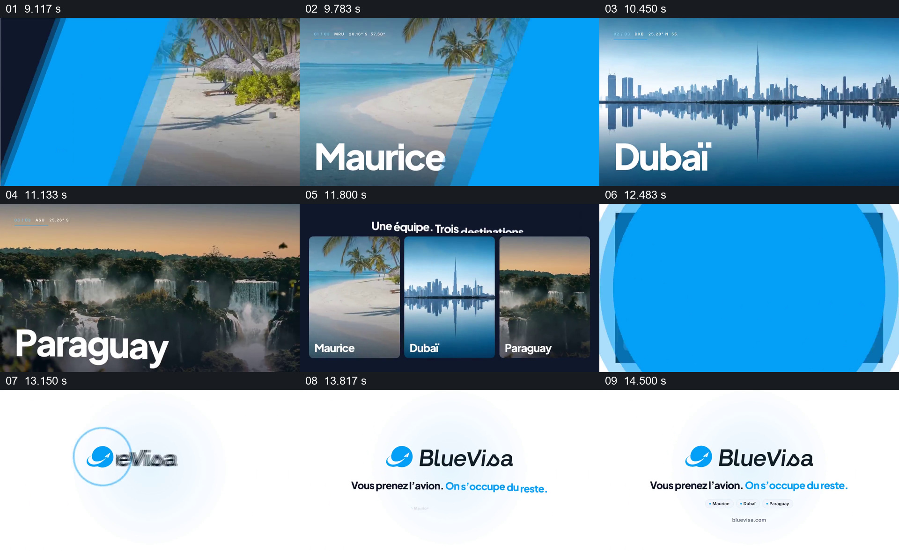

# 先逐地观看，再把目的地汇成三张卡

- 作品：案例 015《旅行影像与品牌排版》（索引名称）。
- 原片范围：00:09.000–00:15.061，含起点、不含终点；[完整原片](../video.mp4)｜[本卡片段](c02.mp4)。
- 观察方式：依据整片 64 宫格和约每秒一次的真实源帧观察，未连续原速观看或听审；声音、语气与完整播放节奏未确认。

## 原画面具体怎样设计

蓝色斜向形状后出现海滩、城市天际线与瀑布景观，画面配有地点名称；随后三幅景观收成并排竖卡，顶部写“一支团队，三个目的地”的法语句子。画面转白后出现 BlueVisa 标识和结尾短句。

## 为什么这样设计，好在哪里

全幅景观给每个地点一个被单独看见的机会，三卡汇总则把已看过的内容收在同一视野里，观众可以重新比较覆盖范围。地点名称与素材对应关系以及旅行服务是否覆盖这些地点并未在本次核查。

以上为依据画面的分析，非作者自述；预期观看效果未经观众测试。

## 可直接使用的创意指令

当需要展示多个地点并最终汇总时，为每个地点准备可授权、地理对应已确认的影像和名称，先逐一给出足够辨认的单独画面，再把同一批画面收成清晰并列的卡片，用一句经核实的范围说明收束。数量、卡片比例和阅读时长按新内容调整；素材未核实时标明示意。
