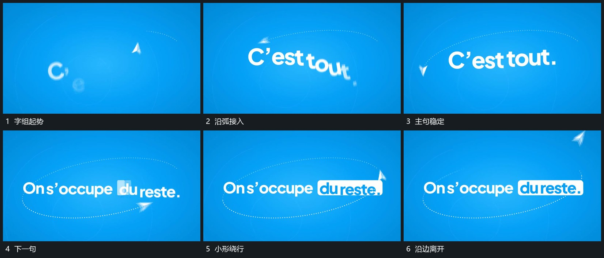

# 字沿弧线接续入位，小形绕行后退出

## 运动指令

使短字沿弧线接续进入中央位置，逐渐组成稳定字组。小前景形沿外围弧线绕行，文字更新时它仍继续，最后沿边离开。

## 视频切片

[播放本机制的原片切片](m02.mp4)

覆盖分镜中“字组起势”至“沿边离开”的连续过程，并保留邻近的前后衔接画面；原片中交叠发生的动作一并保留。

## 分镜过程

## 组合与调整

路径幅度可改，文字要回到可读的位置，不能一直在环上转动。
