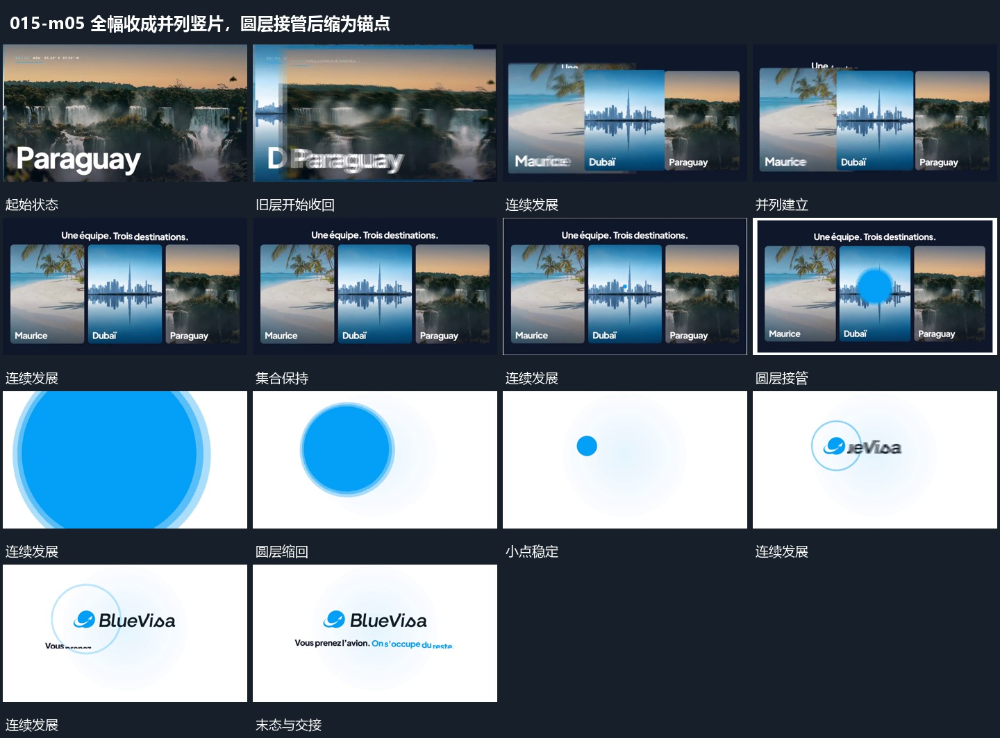

# 全幅收成并列竖片，圆层接管后缩为锚点

## 运动指令

将多个全幅各自收成并列竖片，集合建立后保持。圆形层从集合中部扩大接管，再缩回成小点，围绕小点建立标记与短行收尾。

## 视频切片

[播放本机制的原片切片](m05.mp4)

覆盖分镜中“旧层开始收回”至“小点稳定”的连续过程，并保留邻近的前后衔接画面；原片中交叠发生的动作一并保留。

## 分镜过程

## 组合与调整

圆形接管与收小是两个方向的动作，缩小后需给下一字组明确锚点。
