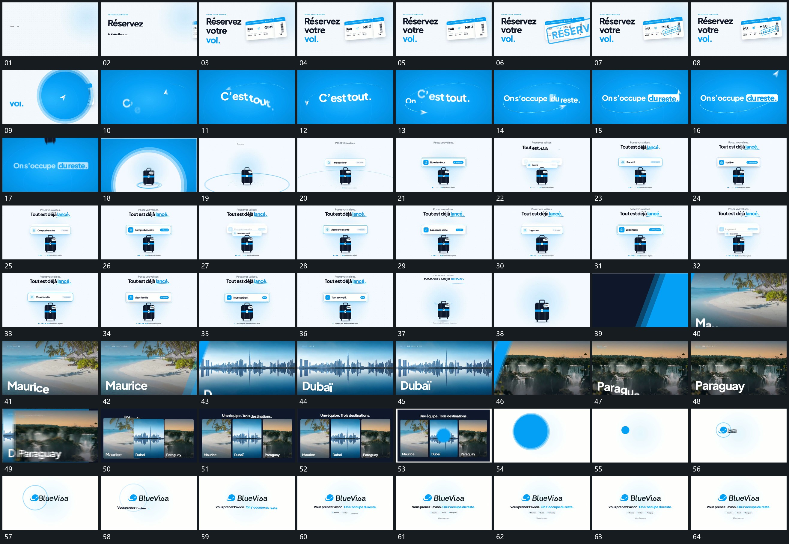

# 015｜原片运动总览

[观看完整原片](video.mp4)

## 运动总览

开头主字分行建立，侧方片面倾斜入位，内部轮换后标记叠入 从侧方接入倾斜片面，内部短字快速轮换，倾斜标记随后叠入。圆形层扩大后进入新底，字沿弧线接续入位，小形绕行后退出 让字沿弧形路径接续入位，前景小形绕行并离开。

随后 中心体落入，下方点列累计而上卡接续更换 从上方落下中心体，上方短卡依次替换，完成状态留在卡内，下方点列累计。主组退出后 斜向带经过，后缘揭出下一全幅与字组 用斜向带连续接替多个全幅，字组从下方接上。

后段 全幅收成并列竖片，圆层接管后缩为锚点 将全幅收成并列竖片，集合保持后圆形层覆盖、缩为小点，再补标记和短行。重复短卡轮换只保留一条指令。

## 完整运动段落

以下按原片中的出现顺序引用。建立、内部发展及完成反馈放在同一段中；同时发生的局部动作与运镜写在同一份指令里。不同段之间可以是连续接管，也可以是直接切换，不能仅凭条目相邻认定可直接拼接。重复出现的同类运动采用一次连续代表范围，切片不以逐段无缝覆盖整片为目标。

1. [侧方片面倾斜入位，内部轮换后标记叠入](mechanisms/m01.md)：外片保持，内部更新与标记追加错开

2. [字沿弧线接续入位，小形绕行后退出](mechanisms/m02.md)：字组归到中部，小形沿周边弧线独立行进

3. [中心体落入，下方点列累计而上卡接续更换](mechanisms/m03.md)：中心固定，上方卡轮换，已完成点保留

4. [斜向带经过，后缘揭出下一全幅与字组](mechanisms/m04.md)：斜带负责遮蔽，后缘露出下一层

5. [全幅收成并列竖片，圆层接管后缩为锚点](mechanisms/m05.md)：先收全幅为集合，再以圆层集中观看

切片保留起始准备、必要内部停顿和完成或明确交接；首尾省略无新发展的等待，持续运动不要求人为停住。以上基于真实源帧序列和重点边界核对，不等同于全片连续声画审片。

## 完整64宫格

