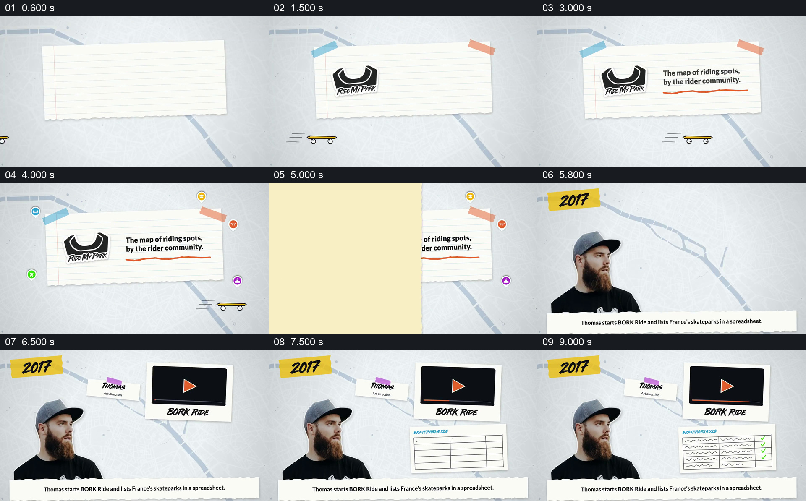

# 让项目定位落到发起者与一张逐渐填满的清单

- 作品：案例 002《分批进入与横向遮挡接续》（库内索引名）。
- 原片范围：00:00.000–00:09.800，含起点、不含终点；[完整原片](../video.mp4)｜[本卡片段](c01.mp4)。片段内时间从原片 0.000 秒开始。
- 边界依据：从项目定位开始，到人物、旧项目和清单共同呈现起点；随后切到另一个年份的地区分布。
- 观察方式：核看完整原片 64 帧总览及本卡九宫格。未独立完成连续原速观看与听审；精确运动、停顿、声音落点和新题材迁移效果仍待核验。作品中的年份、人物关系与数字仅按画面呈现记录，未独立查证。

## 原画面具体怎样设计

**先建立项目是什么。** 淡灰地图与斜向河道占满背景，一张撕边横线纸置于中央，两端有彩色胶带。纸左侧出现 Ride My Park 标识，右侧出现“The map of riding spots, by the rider community.”，橙色手绘线位于文字下方；几枚彩色地点标记分布在纸张周围，底边还有小滑板图形。画面先把注意集中在标识与定位，地图与标记说明这份纸页所指向的空间。

**把当前身份接回过去的行动。** 约 00:05，浅黄色纸面遮住开场卡；其后地图背景重新露出，左上贴上“2017”，Thomas 的人物剪影位于画面偏左。底部撕边文字说明他开始 BORK Ride 并列出法国滑板场，人物旁上方出现姓名与职责小卡。

**用具体物件把人物和工作放到同一画面。** 人物右侧上方是一张写着 BORK Ride 的播放页面式卡片，下方依次出现“SKATEPARKS.XLS”表格、分行和勾选标记。人物、旧项目和表格在同一地图背景中保留：视线从人物移向上方的项目卡，再转向逐步填满的表格；到 00:09 左右，表格已有多行内容与绿色勾选，形成可以看懂的起步结果。

## 为什么这样设计，好在哪里

项目介绍没有停在一个名称上。先看到“地点地图由社区构建”的定位，再看到一个人、一个旧项目和一份工作清单，观众可以把抽象的项目身份与画面里可见的行动联系起来。地图底纹跨越两种构图，年份与纸张样式承担时间和载体的共同参照。

如果只留下人物姓名，观众知道谁参与，却看不到他从事什么；如果只展示表格，也少了行动与人物的对应。旧项目卡放在表格上方，先交代工作背景，表格再通过行与勾的增加给出积累过程。以上为画面分析；片中项目经历、年份与地点清单没有在本次另行核实。

## 完整照排指令

以[本地原片](../video.mp4) 0.000–9.800 秒为准，16∶9，1280×720、30 帧/秒。下述位置按画宽、画高的百分比取近似值，拍点按时间序列定位。

### 用料

- 【城市底图】取浅灰街网和一条从左上贯穿到右下的河道。两版共用同一取景比例，保留纸页以外仍能辨认的河线。【地点标记】可用三至五个来自项目的类别图标，颜色要能区分，图例与真实地点对应时提供实际坐标。
- 【项目标识】用横向透明图，保留图案主体与下方小字。【项目定位】准备两行短文，说明项目做什么、由谁贡献。
- 【起始年份】【发起者姓名】【发起者职责】【阶段说明】须与真实早期记录对应。另备【发起者肖像】可抠出头肩躯干、望向右侧的图，【早期项目预览】【早期项目名】须属于同一人参与的早期成果，【清单文件名】【清单条目】须对应这一成果实际整理的对象。提供项目历史、旧页面或原表的可打开链接或存档页及日期。

### 按源时刻摆放

1. **0.000–1.000 秒。** 【城市底图】满铺并压低反差。白色横线纸从小版迅速长到画面 x17%–84%、y19%–68%，上沿轻微抬向右侧，保留撕边和薄阴影。左上蓝胶带先压上纸角，右上再出现斜贴的橙胶带。底部的小滑板带几笔灰速度线，从左边进入。约 1 秒时【项目标识】已立在纸内左半，黑色图案和标识小字连成一块，高约画高五分之一。
2. **1.000–4.750 秒。** 标识留在纸上。约 2 秒从纸面右半沿文字底边向右画橙色短线，约 2.75 秒上线两行黑色粗体【项目定位】，左齐，线贴在整个字组下方。随后让【地点标记】在纸外左上、右上、左下及右下分散出现。任何标记都避开主要字组。纸层保持，滑板在其下继续横穿，约 4.25 秒已靠右边，完整横穿只做一次。滑板是图形运动层，可用静态图沿直线平移。
3. **约 4.750–5.500 秒。** 浅黄满幅色块从左横向遮过地图、整张纸、周围标记及滑板。随后色块右移，左侧先露出地图和贴在 x4%、y3% 的小黄【起始年份】条，文字用偏粗斜手写体。地图回到相同尺度。人物露出前让遮挡继续离场。
4. **约 5.500–7.500 秒。** 【发起者肖像】立在左侧，占宽约 43%，头顶约 y25%，躯干落到 y85%。人物视线指向右半。【阶段说明】用下方近满宽的白撕边纸承载，黑色小字居中单行。肖像右上叠略倾的小白卡，先排粗黑【发起者姓名】，其下用更小字排【发起者职责】，给淡紫贴纸露出一角。右上 x53%–90%、y9%–48% 放略斜的白边【早期项目预览】，黑屏上居中橙色播放三角，下面用黑色粗斜体【早期项目名】。原片该预览以封面状态保持，可用定格或实物截图。肖像层可用静态抠图，保留微小整体位移。
5. **约 7.500–9.800 秒。** 左边人物、右上预览、年份和底部说明原位留着。右下 x52%–90%、y53%–81% 接入白表格，先由青色短条承载【清单文件名】，表线由半成形到完整，再从上到下写入【清单条目】并点亮对应右侧绿勾。保持预览在上、表格在下，表格需有足够真实条目撑到数行。约 9.75 秒下一段浅蓝遮板从左露头，表格在右侧最后被遮。若全段在此切出，于 9.800 秒在遮板运动中接下一张卡。

### 局部采用

只有项目身份材料时，可用 0.000–约 4.750 秒，留住定位与四周标记后切在黄纸初入处。只有起步史材料时，从约 5.250 秒黄纸让出年份开始，用到 9.800 秒；须同时给出人物和能归属到该人的工作记录。

### 验证状态

本轮从原片 0–10 秒抽取 4 帧/秒时间序列对稿。复核 2.25 秒橙线先于定位文字、约 5.25 秒黄纸退出时年份先显、8.75 秒表格与右上预览同在。逐帧边界、听审和换料试摆待核。
