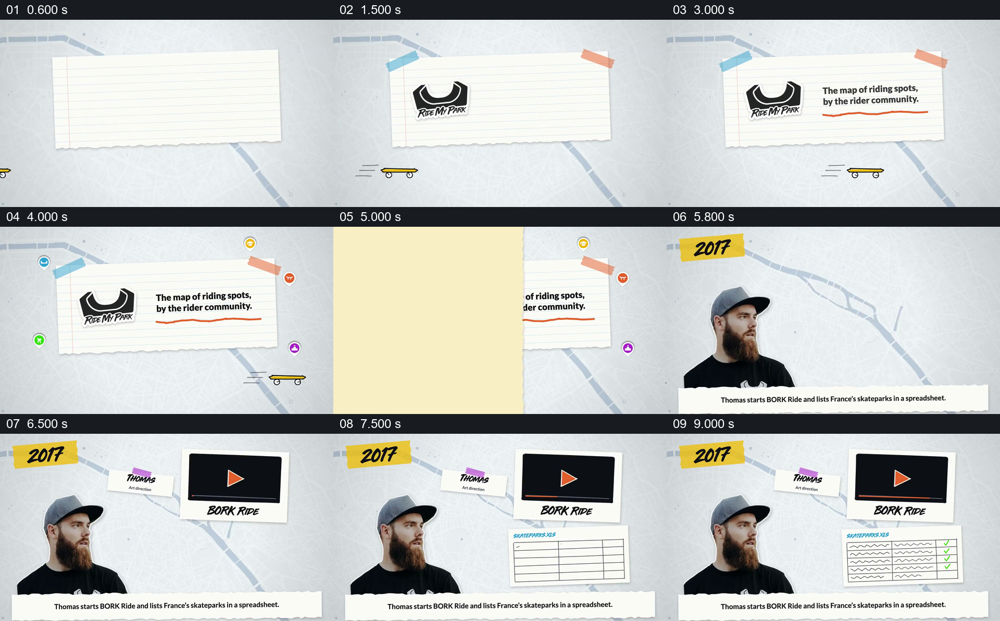

# 用人物、旧项目和清单交代地图的起点

- 作品：案例 002《分批进入与横向遮挡接续》（索引名称）。
- 原片范围：00:00.000–00:09.800，含起点、不含终点；[完整原片](../video.mp4)｜[本卡完整片段](c01.mp4)。
- 观察方式：按整片 64 宫格顺序检查，并在原片各段约每秒抽帧、对交界加密观察；本卡分镜为原片真实帧。未连续原速观看或听审，声音内容与语气未确认。

## 原画面具体怎样设计

画面先在地图底纹上展开一张贴着胶带的横线纸，放入 Ride My Park 标志，补出“由骑行者社区制作的骑行地点地图”以及周围的地点图标。纸片横向遮过画面后，2017 年份和人物 Thomas 出现；右侧先是 BORK Ride 的视频样式卡片，再出现写着 SKATEPARKS.XLS 的表格。表格逐行出现示意文字与勾选，底部画内文字称 Thomas 开始 BORK Ride，并用表格记录法国的滑板场。

## 为什么这样设计，好在哪里

项目定位、人物和当年的具体工作同时可见，抽象的“项目创立”落到了一个人如何开始整理地点上。表格从空行逐渐填满，给收集过程一个可见的方向；它是编辑绘制的示意表，不能当作原始表格证据。 以上为作品分析，不代表作者自述或已测量的观众反应。

## 可直接使用的创意指令

当需要解释一个项目的起点，且有可靠的发起人、最初工作和材料对象时，先用简短的项目定位让观众知道成品服务谁，再建立发起人的身份与当时的工作环境。选择与起步工作相关的真实材料或明确标注的示意物，在人物旁展示其从空白到有内容的积累，让人、行动和产生的资料保持同一空间关系；完成后再接后续成果。年份、素材形式和图形风格可按内容调整；引用具体人数、地点或文件时，以来源为准，示意界面不能冒充原始记录。
