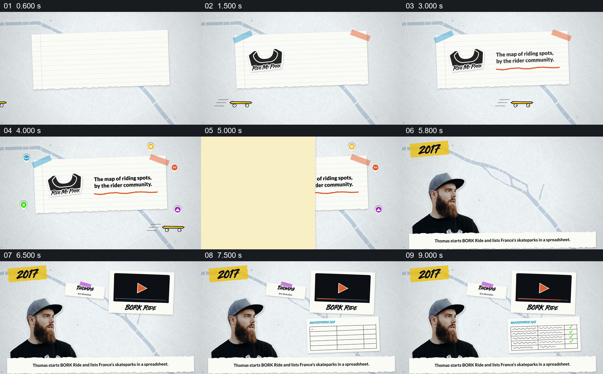

# 让项目定位落到发起者与一张逐渐填满的清单

- 作品：案例 002《分批进入与横向遮挡接续》（库内索引名）。
- 原片范围：00:00.000–00:09.800，含起点、不含终点；[完整原片](../video.mp4)｜[本卡片段](c01.mp4)。片段内时间从原片 0.000 秒开始。
- 边界依据：从项目定位开始，到人物、旧项目和清单共同呈现起点；随后切到另一个年份的地区分布。
- 观察方式：核看完整原片 64 帧总览及本卡九宫格。未独立完成连续原速观看与听审；精确运动、停顿、声音落点和新题材迁移效果仍待核验。作品中的年份、人物关系与数字仅按画面呈现记录，未独立查证。

## 原画面具体怎样设计

**先建立项目是什么。** 淡灰地图与斜向河道占满背景，一张撕边横线纸置于中央，两端有彩色胶带。纸左侧出现 Ride My Park 标识，右侧出现“The map of riding spots, by the rider community.”，橙色手绘线位于文字下方；几枚彩色地点标记分布在纸张周围，底边还有小滑板图形。画面先把注意集中在标识与定位，地图与标记说明这份纸页所指向的空间。

**把当前身份接回过去的行动。** 约 00:05，浅黄色纸面遮住开场卡；其后地图背景重新露出，左上贴上“2017”，Thomas 的人物剪影位于画面偏左。底部撕边文字说明他开始 BORK Ride 并列出法国滑板场，人物旁上方出现姓名与职责小卡。

**用具体物件把人物和工作放到同一画面。** 人物右侧上方是一张写着 BORK Ride 的播放页面式卡片，下方依次出现“SKATEPARKS.XLS”表格、分行和勾选标记。人物、旧项目和表格在同一地图背景中保留：视线从人物移向上方的项目卡，再转向逐步填满的表格；到 00:09 左右，表格已有多行内容与绿色勾选，形成可以看懂的起步结果。

## 为什么这样设计，好在哪里

项目介绍没有停在一个名称上。先看到“地点地图由社区构建”的定位，再看到一个人、一个旧项目和一份工作清单，观众可以把抽象的项目身份与画面里可见的行动联系起来。地图底纹跨越两种构图，年份与纸张样式承担时间和载体的共同参照。

如果只留下人物姓名，观众知道谁参与，却看不到他从事什么；如果只展示表格，也少了行动与人物的对应。旧项目卡放在表格上方，先交代工作背景，表格再通过行与勾的增加给出积累过程。以上为画面分析；片中项目经历、年份与地点清单没有在本次另行核实。

## 可直接使用的创意指令

适用于需要说明一个集合、社区或资料项目如何起步的内容。先准备能准确表达当前项目的名称和一句定位，再选择确有对应关系的发起者材料、早期成果与一项能体现持续劳动的具体记录。让当前定位先在稳定的承载空间中成立，再引入时间标识和人物；将早期成果放在人物附近，用清单、记录卡或其他合适材料展示内容逐步被收集的状态。

保持人物、成果与记录之间的可追踪关系，让观众知道谁在做什么，再把完成的初始积累交给后续发展。人物形式、年代标签、地图、纸页和表格样式都可改变；记录里的数量或经历需与实际资料一致。如果没有可靠起步材料，就应以已有事实建立起点，避免用示意清单暗示未经证实的工作过程。
