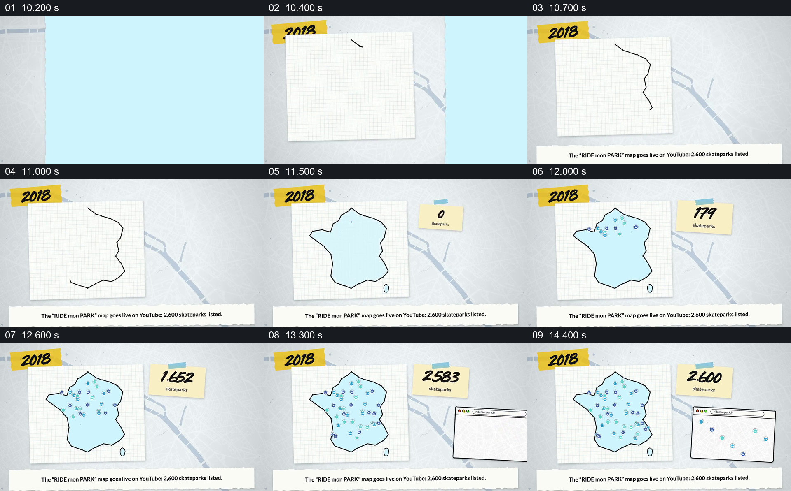

# 先画出区域边界，再让地点与计数共同增长

- 作品：案例 002《分批进入与横向遮挡接续》（库内索引名）。
- 原片范围：00:10.100–00:14.800，含起点、不含终点；[完整原片](../video.mp4)｜[本卡片段](c02.mp4)。片段内时间从原片 10.100 秒开始。
- 边界依据：从新年份的区域轮廓建立，到地图、最终数量及网页式结果共同可见；下一个年份开始另一项成员与产品表达。
- 观察方式：核看完整原片 64 帧总览及本卡九宫格。未独立完成连续原速观看与听审；精确运动、停顿、声音落点和新题材迁移效果仍待核验。作品中的年份、人物关系与数字仅按画面呈现记录，未独立查证。

## 原画面具体怎样设计

**建立承载范围。** 蓝色纸面退开后，地图底纹上保留左上角“2018”，一张方格纸位于画面中央偏左。方格纸上先出现一段黑线，随后在约 00:10.7–00:11.5 的源帧中延展为法国轮廓，并填充浅蓝色，右下保留科西嘉岛的轮廓。背景地图与年份保持不变，最初的注意力集中在正在显露的区域。

**让空间和规模一起变化。** 区域完成时，右侧胶带贴着的黄色便笺显示“0 skateparks”；接下来的源帧中，彩色圆形地点标记陆续出现在法国轮廓内，便笺数值从 179、1,652 变化至 2,600。数字不盖住地图，地点与计数分别占据左右区域，观众可以同时看到分布和规模，而不是只能看到一个数字。

**把示意结果接到使用界面。** 约 00:13.3，右下出现浏览器式窗口，起初页面内容很少；至 00:14.4，窗口内也出现地图纹理和地点标记。左侧满布标记的法国轮廓、右上 2,600 便笺与右下页面同时留在画面，形成“区域集合—总量—展示入口”的结果。底部文字将其归于片中所述的 2018 年阶段。

## 为什么这样设计，好在哪里

先给边界再给标记，地点就有了明确的空间容器；便笺上的数字又为零散点位提供总量参照。地图和数字在相邻位置共同成立，比让数量单独快速跳过更容易看出本段是在说明地点集合的扩充。网页小窗最后出现，并保留前面的完整地图与数量，使观众能把结果与展示载体联系起来。

这里的点并非可以直接数出 2,600 个地点；它们是规模与分布的视觉示意。省略区域或省略计数，分别会削弱“地点在哪里”或“集合有多大”的信息；把点位直接说成真实坐标，则超出了画面的证据。

## 完整照排指令

以[本地原片](../video.mp4) 10.100–14.800 秒为准，16∶9，1280×720、30 帧/秒。下述拍点来自原片时间序列，位置按画幅百分比近似。

### 用料

- 【背景地图】提供与前后段一致的浅灰街网、斜河道。【区域轮廓】提供可画出主体封闭线和必要离岛的地理边界，简化程度以小画面仍可认出为准。
- 【地点标记】提供可对应的地点集合或代表性位置，颜色可区分类别。使用示意分布时，画面说明应标明示意。【年份】【地点终值】【地点单位】【阶段说明】共用同一时期、区域和统计口径。保存可打开的数据或项目档案、统计日期、口径页和实际可核对的结果。
- 【地图页面】取能表现同一地区、同一地点集合的真实浏览器地图，留顶部界面和展开的地图区域。窗口内严格对位到该集合，若网页只展示抽样子集，说明抽样关系。

### 按源时刻摆放

1. **10.100–约 10.500 秒。** 浅蓝遮板承接上一场，从左至右退出。左上露出 x4%、y4% 的黄色小贴纸，黑色粗斜字【年份】居中。露出的底仍是【背景地图】。在 x11%–55%、y14%–80% 放近正立的白方格纸，细灰格线、轻阴影。年份略压在方格纸左上。右半先留空。
2. **约 10.375–11.375 秒。** 薄黑线从纸上部中央起笔，先向右行，沿【区域轮廓】右侧下行、转过下边，最后从左侧向上闭合。整体宽约白纸七成，保持四周留白。主线闭合后出现小岛轮廓，主体填淡蓝，等到区域成立再铺地点。约 10.750 秒在底端进一条近满宽的白纸，黑色【阶段说明】居中单行，保持至切出。
3. **约 11.500–13.375 秒。** 在 x58%–80%、y13%–38% 贴一张浅黄便笺，上缘跨一段青蓝胶带。先写黑色粗斜数字 0，下一行用远小的黑字排【地点单位】，上下居中。约 11.75 秒起先在轮廓北部零星显出【地点标记】，再在区域其他部分分批增加。便笺数字同步快速跳升，接近【地点终值】时减速，约 13.375 秒保持终值。原片示例画面约 11.875 秒读 25、12.125 秒读 179、13.125 秒读 2559、13.375 秒读 2600；换值时保留先疏后密与先快后慢的相对关系。便笺中的过程整数是演出，终值和底注采用核过的数字。
4. **约 13.125–14.800 秒。** 右下从画右接入带细黑边的【地图页面】，约 13.375 秒形成立在 x62%–95%、y45%–81% 的小窗，右端略低。独立绘制顶栏的三枚小圆点和细地址栏，把页面裁在框内。先留空白页，再于约 13.625 秒起逐渐显出内部点位，随后露出浅地图纹理。过程可用静态真实截图的分层显隐，页面框进场后一直留到切出。左边的满图、右上终值、右下页面和底注共同保持。约 14.75 秒后下一场的浅绿板开始从左遮过，按 14.800 秒边界接出。

### 局部采用

只有区域与真实计数时，可使用 10.100–约 13.125 秒的前段布局，将计数收稳在网页露出之前并从完整地图和便笺切出。这是局部改排，原片终值在网页进场后才读到。只有网页截图时，无法单独承接从空白区域到地点累积的演出。

### 验证状态

本轮从原片 10–15 秒抽取 8 帧/秒时间序列对稿。复核 11.50 秒先见闭合轮廓与零值、约 13.125 秒网页边先露出且便笺仍在计数、14.375 秒三项同在，防止网页进场时提前撤掉地图或便笺。逐帧边界、听审和换料试摆待核。
