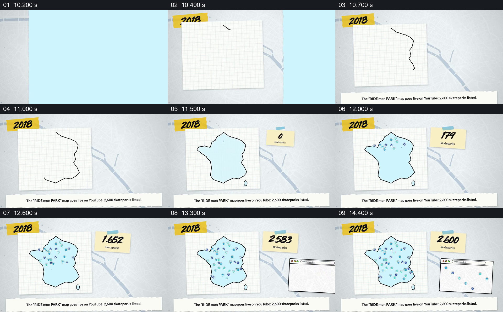

# 先画出区域边界，再让地点与计数共同增长

- 作品：案例 002《分批进入与横向遮挡接续》（库内索引名）。
- 原片范围：00:10.100–00:14.800，含起点、不含终点；[完整原片](../video.mp4)｜[本卡片段](c02.mp4)。片段内时间从原片 10.100 秒开始。
- 边界依据：从新年份的区域轮廓建立，到地图、最终数量及网页式结果共同可见；下一个年份开始另一项成员与产品表达。
- 观察方式：核看完整原片 64 帧总览及本卡九宫格。未独立完成连续原速观看与听审；精确运动、停顿、声音落点和新题材迁移效果仍待核验。作品中的年份、人物关系与数字仅按画面呈现记录，未独立查证。

## 原画面具体怎样设计

**建立承载范围。** 蓝色纸面退开后，地图底纹上保留左上角“2018”，一张方格纸位于画面中央偏左。方格纸上先出现一段黑线，随后在约 00:10.7–00:11.5 的源帧中延展为法国轮廓，并填充浅蓝色，右下保留科西嘉岛的轮廓。背景地图与年份保持不变，最初的注意力集中在正在显露的区域。

**让空间和规模一起变化。** 区域完成时，右侧胶带贴着的黄色便笺显示“0 skateparks”；接下来的源帧中，彩色圆形地点标记陆续出现在法国轮廓内，便笺数值从 179、1,652 变化至 2,600。数字不盖住地图，地点与计数分别占据左右区域，观众可以同时看到分布和规模，而不是只能看到一个数字。

**把示意结果接到使用界面。** 约 00:13.3，右下出现浏览器式窗口，起初页面内容很少；至 00:14.4，窗口内也出现地图纹理和地点标记。左侧满布标记的法国轮廓、右上 2,600 便笺与右下页面同时留在画面，形成“区域集合—总量—展示入口”的结果。底部文字将其归于片中所述的 2018 年阶段。

## 为什么这样设计，好在哪里

先给边界再给标记，地点就有了明确的空间容器；便笺上的数字又为零散点位提供总量参照。地图和数字在相邻位置共同成立，比让数量单独快速跳过更容易看出本段是在说明地点集合的扩充。网页小窗最后出现，并保留前面的完整地图与数量，使观众能把结果与展示载体联系起来。

这里的点并非可以直接数出 2,600 个地点；它们是规模与分布的视觉示意。省略区域或省略计数，分别会削弱“地点在哪里”或“集合有多大”的信息；把点位直接说成真实坐标，则超出了画面的证据。

## 可直接使用的创意指令

当内容确有明确地理范围、可核实的地点与统计口径时，先选取适合观众辨认的区域轮廓或位置底图，将其放在主要阅读区。待边界明确后，按内容需要逐步显露代表性位置，同时在邻近而不遮挡地图的区域显示相应总量；保持单位、统计时间和数字口径清楚。

如果需要把收集结果带向产品或资料库，再引入能实际展示该集合的页面或其他载体，让已有空间和总量在交接中保持可见。地图形状、标记色彩、数字载体与页面样式可替换；要保留“区域范围先成立—地点和总量有对应—最终有可读结果”的关系。若位置或总量不可核实，应明确示意，不能把抽样点的数量当成真实总数。
