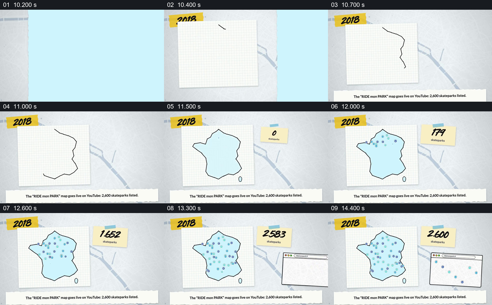

# 先画出区域，再让地点和数量一起增长

- 作品：案例 002《分批进入与横向遮挡接续》（索引名称）。
- 原片范围：00:10.100–00:14.800，含起点、不含终点；[完整原片](../video.mp4)｜[本卡完整片段](c02.mp4)。
- 观察方式：按整片 64 宫格顺序检查，并在原片各段约每秒抽帧、对交界加密观察；本卡分镜为原片真实帧。未连续原速观看或听审，声音内容与语气未确认。

## 原画面具体怎样设计

2018 年出现后，一张方格纸上的线逐步围成法国轮廓并填成浅蓝色。旁边的便签显示地点数量，地图内部的彩色小标记不断增加，数字也从零升至 2,600；随后右下方出现浏览器样式的地图窗口，继续出现地点标记。底部文字称该地图上线，并列有 2,600 个滑板场。

## 为什么这样设计，好在哪里

先画出地理范围，再同时增加点与总数，观众能把数量与“这些地点分布在什么范围”联系起来。右侧浏览器窗口把地图从纸面示意接到可供使用的页面。画面中的点是概括性图形，数量与上线描述是原片说法，不能据此确认每个点的实际坐标或独立核实总数。 以上为作品分析，不代表作者自述或已测量的观众反应。

## 可直接使用的创意指令

当一项内容涉及某一区域内可统计的地点，并且地域范围和总量有真实依据时，先建立可辨认的区域轮廓，让观众知道统计边界；再在区域内逐步加入地点符号，并在同一段中显示对应的数量变化。若还需交代成果在哪里使用，可在主要地图保持可见时引入页面或工具的简化视图，说明它与前面集合的关系。地图精度、数字口径和时间应与资料一致；示意点与真实地理坐标要明确区分，数字跳动不代表实际逐条录入过程。
