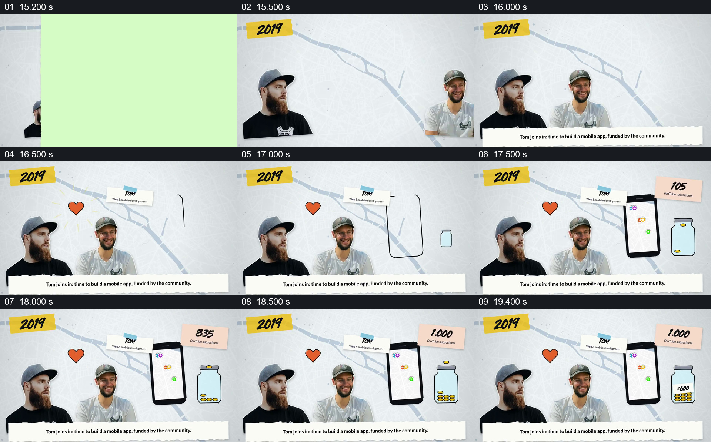

# 把新成员、手机和社区支持并置在同一阶段

- 作品：案例 002《分批进入与横向遮挡接续》（库内索引名）。
- 原片范围：00:15.100–00:19.800，含起点、不含终点；[完整原片](../video.mp4)｜[本卡片段](c03.mp4)。片段内时间从原片 15.100 秒开始。
- 边界依据：从两位成员建立到手机、订阅数和装有硬币的罐子形成完整结果；之后进入新年份与团队合并。
- 观察方式：核看完整原片 64 帧总览及本卡九宫格。未独立完成连续原速观看与听审；精确运动、停顿、声音落点和新题材迁移效果仍待核验。作品中的年份、人物关系与数字仅按画面呈现记录，未独立查证。

## 原画面具体怎样设计

**先让两位参与者同时成立。** 绿色纸面退开后，左上为“2019”，Thomas 的人物剪影位于左侧，Tom 从右侧进入并与他并排。人物之间上方出现橙色爱心，Tom 的名字及“Web & mobile development”小卡位于他右上方；底部纸条把这一阶段描述为 Tom 加入、开发移动应用并获得社区资助。

**在人物旁建立他们共同关联的对象。** 两人留在左侧，画面右侧先出现手机外轮廓，再变成有黑色边框的手机地图；地图内是不同颜色的地点标记。手机右侧有一个透明罐，手机上方偏右有一张写着 YouTube subscribers 的数字便笺。人物没有让位给大幅产品特写，手机与人物同时可见，画面从“谁加入”转向“他们要做什么”。

**用两种不同反馈补全支持这一信息。** 约 00:17.5–00:19.4 的分镜中，订阅数便笺从较小数字变为 1,000；罐子里同时可见越来越多的黄色硬币，最后出现“€600”。两人、手机、爱心、订阅数和罐子构成最终画面。便笺与罐子分别是片中的订阅和资金视觉符号，两者不是同一个统计单位。

## 为什么这样设计，好在哪里

人物并排先建立协作，再把手机放到他们身旁，观众无需从一张只有文字的履历卡猜测新成员与产品的联系。爱心、订阅便笺和零钱罐把“社区支持”分散到不同的可见对象上：一个强调关系，一个呈现关注数量，另一个呈现片中所述的金额。

两个人不退出，产品和支持信息才有稳定的对应主体；如果只把订阅数和金额全屏轮播，指标可以读到，但它们与共同开发者、手机地图的关系会弱一些。订阅数、€600 及资金用途是片中的表达，本次未核实其真实性或彼此因果。

## 完整照排指令

以[本地原片](../video.mp4) 15.100–19.800 秒为准，16∶9，1280×720，30 帧/秒。位置按画幅百分比取近似值，拍点精度受抽帧间隔限制。

### 用料

- 【街网底图】取低反差浅灰街网与贯穿画面的斜河道，沿用相邻段尺度。【年份】准备一个年份。【原成员肖像】【新成员肖像】用同团队两位成员可抠出的半身图，脸与肩线分开，原成员向画中，新成员面向观众。【新成员姓名】【新成员职责】和底部单行【阶段说明】须对应真实参与关系。
- 【手机界面】须能展示本阶段真实产品中的地图与分类标记，提供竖屏裁切和独立标记层。【支持终值】【支持单位】【筹款结果】准备各自可核对的数字和单位，支持者总量、筹款结果分属两个位置。提供当年的项目发布记录或筹款页面及统计日期、原始口径。罐、爱心和钱币为绘制层。

### 按源时刻摆放

1. **15.100–15.700 秒。** 浅绿遮板继续向右，左上先露出黄贴纸，x4%、y4%，压黑色粗斜【年份】。露出的【街网底图】一直在最底。左下先站稳【原成员肖像】，再从右方引【新成员肖像】横移到左半，与他肩接肩。两者共同占画面左约 52%，底缘至 y85%。接一条近满宽的白撕边纸到画底，居中排黑色小字【阶段说明】。
2. **15.700–16.900 秒。** 在两个人头部上方靠左 x25%、y37% 放橙红心，周围黄线短闪后收掉，爱心本体保留。新成员右上方 x43%、y16% 压细斜白卡，用较大粗黑【新成员姓名】与次级小黑【新成员职责】上下排，留青色强调贴。右半先画细黑竖圆角轮廓，约 16.900 秒已形成近完整手机形，人物、爱心和姓名卡仍在。
3. **16.900–约 17.300 秒。** 手机落在 x63%–79%、y25%–75%，细轮廓转成厚黑描边，白底【手机界面】置于框内，浅地图纹理上逐个出现小彩点。最右 x83%–94% 放黑轮廓浅蓝玻璃罐，下面和手机接近齐底。右上另贴浅粉纸，黑色粗斜大数、下一行小号【支持单位】，数从低值快速上升。手机从露出屏幕起一直留到切出，内部以分层点位显现为主，可用静态界面分层制作。
4. **约 17.300–19.800 秒。** 罐内黄币从上落到罐底并逐步叠起，避免与右上人数跳值一一对应。约 18.500 秒右上收成【支持终值】，约 18.700 秒在罐中币堆上方落黑色【筹款结果】。薄罐身压住硬币边缘，仍看得清淡蓝底。两个人、姓名、心、手机、粉签及罐全部留到末拍。约 19.700 秒桃色下一场遮板从左入，按 19.800 秒切出。

### 局部采用

若只有成员材料，可从 15.100 秒用到约 16.500 秒姓名与爱心建立处，并在手机空轮廓成为信息前退出。只有产品界面时，后半的支持与产品并置缺少出处和筹款结果。

### 验证状态

本轮按 5 帧/秒原片时间序列核对文字。复核约 16.900 秒轮廓先于手机填屏、约 18.500 秒支持终值先稳、约 18.700 秒罐内文字出现且人物仍在原位。连续原速、逐帧边界、听审和换料待核。
