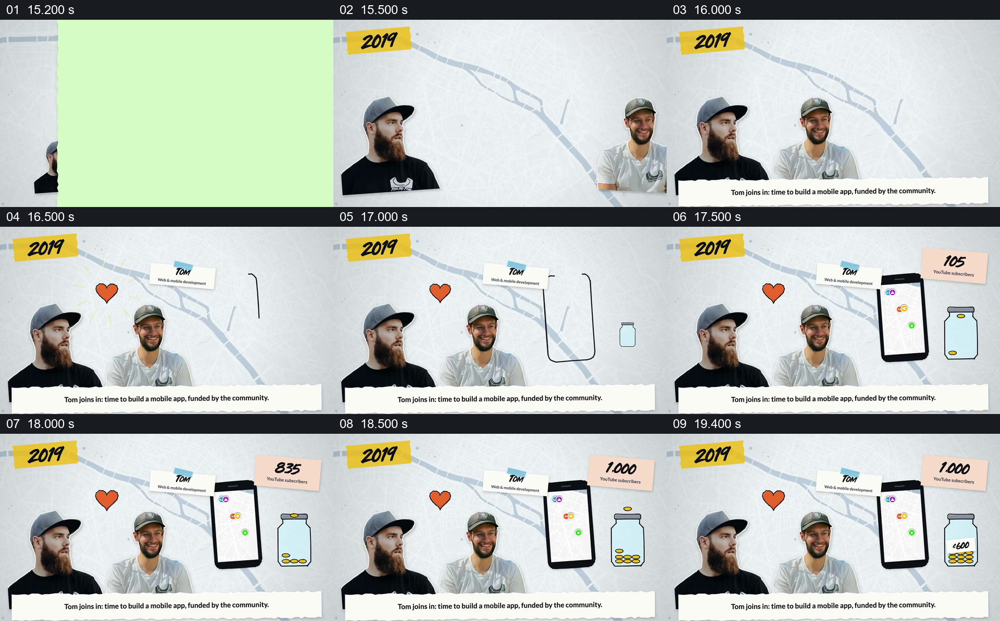

# 把新成员、手机产品和社区支持放在同一画面

- 作品：案例 002《分批进入与横向遮挡接续》（索引名称）。
- 原片范围：00:15.100–00:19.800，含起点、不含终点；[完整原片](../video.mp4)｜[本卡完整片段](c03.mp4)。
- 观察方式：按整片 64 宫格顺序检查，并在原片各段约每秒抽帧、对交界加密观察；本卡分镜为原片真实帧。未连续原速观看或听审，声音内容与语气未确认。

## 原画面具体怎样设计

2019 年份下，两位人物在左侧并列，画面补入 Tom 的姓名和工作标签，两人之间出现爱心。右侧先勾出手机轮廓，再显示带地点标记的地图；同时，一个玻璃罐出现，硬币逐个落入，便签上的 YouTube 订阅数增长至 1,000，罐子标有 €600。底部文字称 Tom 加入、团队要制作移动应用，并由社区资助。

## 为什么这样设计，好在哪里

人物、产品方向和支持反馈保持在同一屏内，能够看出片中把“谁加入”“准备做什么”和“社区如何参与”放在同一阶段，而不是只给一张团队合照。手机与存钱罐各承担不同作用；爱心和硬币是编辑化符号，不足以独立证明资金来源、用途或数量。 以上为作品分析，不代表作者自述或已测量的观众反应。

## 可直接使用的创意指令

当新增合作者和外部支持确实共同影响了产品或项目时，选择能辨认的参与者、其具体职责、要建设的成果以及可核实的支持方式。先让人物与职责成立，再在同一画面中分别建立成果的形态与支持的反馈；保留双方的位置和各自标签，让观众知道谁参与了什么、支持作用于哪里。若使用计数、资金或界面示意，写清口径和来源，不能由装饰符号推断因果；人物数量、图形和时间尺度可按真实材料调整。
