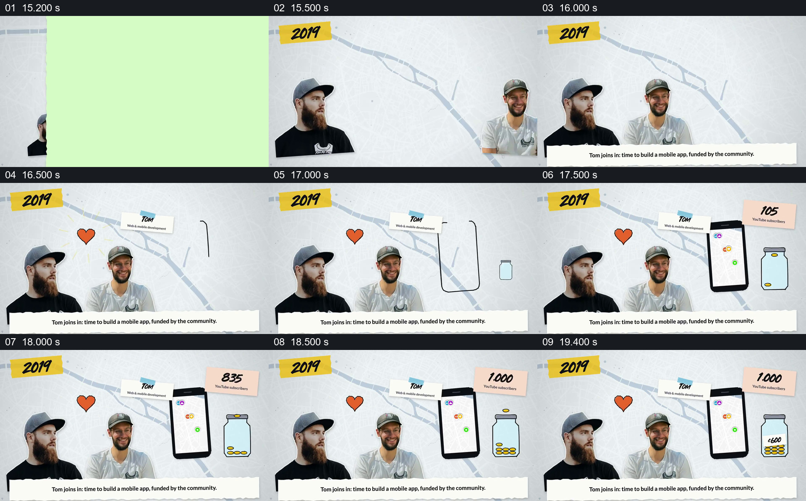

# 把新成员、手机和社区支持并置在同一阶段

- 作品：案例 002《分批进入与横向遮挡接续》（库内索引名）。
- 原片范围：00:15.100–00:19.800，含起点、不含终点；[完整原片](../video.mp4)｜[本卡片段](c03.mp4)。片段内时间从原片 15.100 秒开始。
- 边界依据：从两位成员建立到手机、订阅数和装有硬币的罐子形成完整结果；之后进入新年份与团队合并。
- 观察方式：核看完整原片 64 帧总览及本卡九宫格。未独立完成连续原速观看与听审；精确运动、停顿、声音落点和新题材迁移效果仍待核验。作品中的年份、人物关系与数字仅按画面呈现记录，未独立查证。

## 原画面具体怎样设计

**先让两位参与者同时成立。** 绿色纸面退开后，左上为“2019”，Thomas 的人物剪影位于左侧，Tom 从右侧进入并与他并排。人物之间上方出现橙色爱心，Tom 的名字及“Web & mobile development”小卡位于他右上方；底部纸条把这一阶段描述为 Tom 加入、开发移动应用并获得社区资助。

**在人物旁建立他们共同关联的对象。** 两人留在左侧，画面右侧先出现手机外轮廓，再变成有黑色边框的手机地图；地图内是不同颜色的地点标记。手机右侧有一个透明罐，手机上方偏右有一张写着 YouTube subscribers 的数字便笺。人物没有让位给大幅产品特写，手机与人物同时可见，画面从“谁加入”转向“他们要做什么”。

**用两种不同反馈补全支持这一信息。** 约 00:17.5–00:19.4 的分镜中，订阅数便笺从较小数字变为 1,000；罐子里同时可见越来越多的黄色硬币，最后出现“€600”。两人、手机、爱心、订阅数和罐子构成最终画面。便笺与罐子分别是片中的订阅和资金视觉符号，两者不是同一个统计单位。

## 为什么这样设计，好在哪里

人物并排先建立协作，再把手机放到他们身旁，观众无需从一张只有文字的履历卡猜测新成员与产品的联系。爱心、订阅便笺和零钱罐把“社区支持”分散到不同的可见对象上：一个强调关系，一个呈现关注数量，另一个呈现片中所述的金额。

两个人不退出，产品和支持信息才有稳定的对应主体；如果只把订阅数和金额全屏轮播，指标可以读到，但它们与共同开发者、手机地图的关系会弱一些。订阅数、€600 及资金用途是片中的表达，本次未核实其真实性或彼此因果。

## 可直接使用的创意指令

介绍一个项目的协作阶段时，先确认实际参与者、各自职责、共同产物和可核对的支持信息。把相关人物或团队并置，使用简短身份信息区分角色；随后在旁侧建立他们共同负责的产品或行动对象，让身份与作品在同一观察范围内对应。

确有外部支持时，可选择分别体现关注、资源或参与的真实材料，让不同单位和来源各自清楚；主体保留到产品与支持关系成立，避免数字先于对象出现。人物可以换成机构、设备或群体，爱心、手机和储钱罐也只是原片的形式；不可丢失的是参与者与实际工作、支持方式之间有依据的关系。如果只有单个参与者或没有可追溯的支持记录，应调整叙述，不虚构协作或资助。
