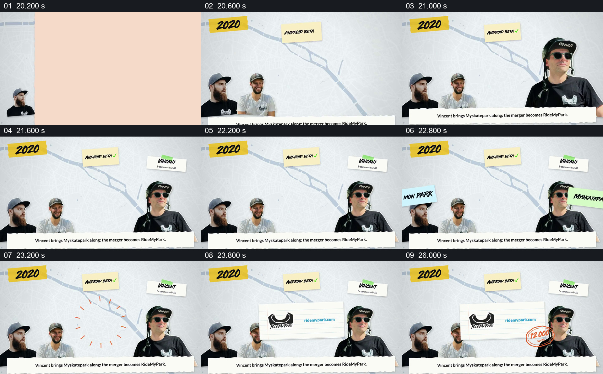

# 让两条项目名称汇合成新的共同标识

- 作品：案例 002《分批进入与横向遮挡接续》（索引名称）。
- 原片范围：00:20.100–00:27.300，含起点、不含终点；[完整原片](../video.mp4)｜[本卡完整片段](c04.mp4)。
- 观察方式：按整片 64 宫格顺序检查，并在原片各段约每秒抽帧、对交界加密观察；本卡分镜为原片真实帧。未连续原速观看或听审，声音内容与语气未确认。

## 原画面具体怎样设计

2020 年出现后，左侧保留之前的两位人物，右侧加入标有 Vincent 的人物，上方另有 Android beta 的便签。两条分别写有 RIDE MON PARK 和 MYSKATEPARK.COM 的纸条从两侧向中间汇合，随后中央出现 Ride My Park 标志和网址，旁边以橙色手绘圈强调“12,000 spots”。底部文字将这一段描述为 Vincent 带来 Myskatepark，合并后成为 RideMyPark。

## 为什么这样设计，好在哪里

新成员和原有人物先同屏，使两边名称的相向运动有了对象；两条名称退出后，中间才出现共同标识，合并前后关系可以在空间上读出来。地点数量补充片中所称规模，但标志、动画和字幕本身不能证明合并过程或统计准确。 以上为作品分析，不代表作者自述或已测量的观众反应。

## 可直接使用的创意指令

当两支团队或两个项目确实合并，并且双方身份和合并后的结果都已确认时，先分别建立参与者与原有名称，让两方在同一画面中保持可辨认。随后让名称或代表性材料向一个共同位置接近，交接给新名称或共同成果；必要时在结果旁补充有来源的规模或时间信息。不要仅因为两个对象同时出现就暗示它们合并，也不要把示意的名称汇合当作法律或业务关系的证据。可按真实材料改变双方的视觉形式、位置和进入方式。
