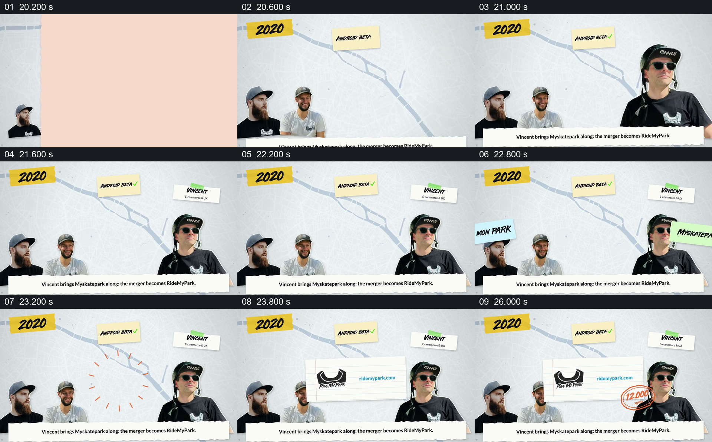

# 让两个原项目名从两侧进入，再出现共同标识

- 作品：案例 002《分批进入与横向遮挡接续》（库内索引名）。
- 原片范围：00:20.100–00:27.300，含起点、不含终点；[完整原片](../video.mp4)｜[本卡片段](c04.mp4)。片段内时间从原片 20.100 秒开始。
- 边界依据：从旧成员与新成员分别建立，到两项名称过渡为新标识及规模结果；下一段换为另一位应用接手者。
- 观察方式：核看完整原片 64 帧总览及本卡九宫格，并在 00:21.8–00:24.0 对约每 0.2 秒源帧做加密核对。未独立完成连续原速观看与听审；精确运动、停顿、声音落点和新题材迁移效果仍待核验。作品中的年份、人物关系与数字仅按画面呈现记录，未独立查证。

## 原画面具体怎样设计

**先把两方放在一个空间。** 淡橙色遮挡退开后，左上年份变为“2020”，原有两个人物位于左下；上方有“ANDROID BETA”便笺。Vincent 的人物剪影在右侧较大位置出现，他的姓名与职责小卡放在其上方。底部文字称他带来 Myskatepark，合并后成为 RideMyPark。

**名称成为两方之间的活动对象。** 约 00:22.6，浅蓝色的“RIDE MON PARK”和浅绿色的“MYSKATEPARK.COM”纸条分别从左右进入，位置靠近两边人物；到 00:23，两条名称进入更靠中间的区域。约 00:23.2，名称不再可见，中央出现橙色放射短线。约 00:23.4，横线纸卡位于两组人物之间，卡片左侧是 Ride My Park 标识，右侧是网址；两边人物仍可见。

**保留合并后的可读结果。** Android 测试便笺和 Vincent 的身份卡仍处于上方；一枚橙色圈注“12,000 spots”出现在新标识附近。新名称、两侧成员与规模信息同时形成结果画面。采样帧支持名称位置的先后变化，但未确认两条纸条在未采到的瞬间是否真正接触或如何变形。

## 为什么这样设计，好在哪里

先把原有成员放左侧、新成员放右侧，两条原名称随后进入这两组人的空间，观众先认识合并的双方；等旧名称从中部退出，再出现新的共同标识，就能沿画面的前后变化理解身份转换。两边人物没有同时清空，新的卡片因此是连接两方的结果，而不是一个孤立的新 Logo。

橙色圈注把规模附着到新身份附近，强调结果所涉及的集合；它的数值和片中的合并关系仍需另行核实。若一开始直接展示新 Logo，会少掉原有两个名称如何被放进同一个结果的对照。

## 可直接使用的创意指令

内容确有两个需要被理解的原团队、品牌或项目，并且已经有经核实的共同身份时，先分别准备两方可识别的主体及名称，安排在画面中能辨认的位置。让名称在保留各自主体的同时进入共同区域，再以明确的阶段变化交给合并后的名称或标识；如有可靠的合并规模，可在结果旁简洁说明口径。

保持旧身份、参与者和新身份之间的前后关系，使观众能说清“谁与谁形成什么”。人物数量、纸条、左右方向、放射线、颜色和具体动作均可重设；名称不需要真正碰撞。对于合作但并未合并的主体，应使用准确的协作关系，不能借画面汇合暗示不存在的所有权或组织变更。
