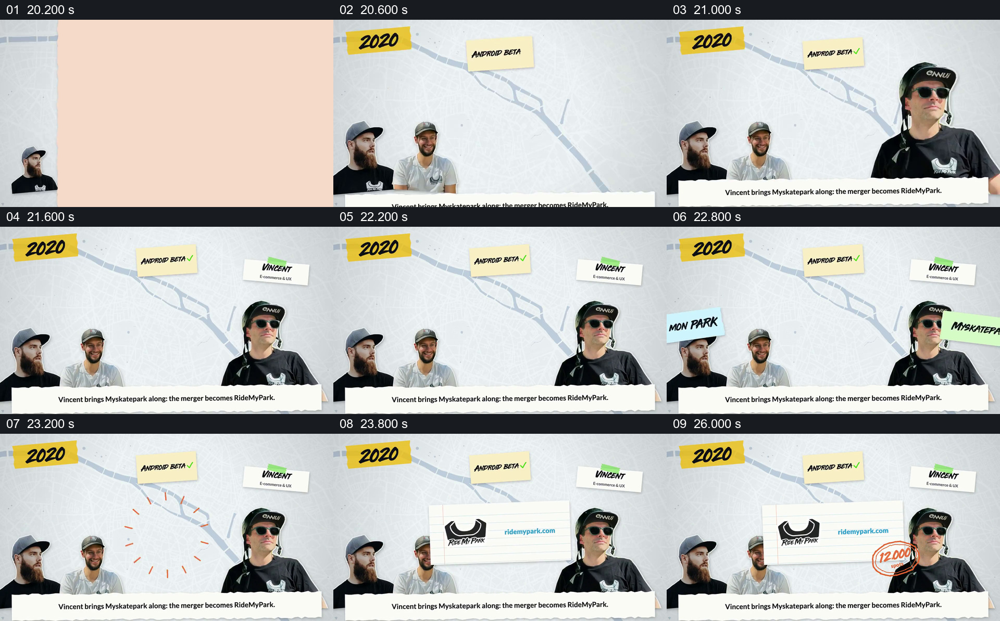

# 让两个原项目名从两侧进入，再出现共同标识

- 作品：案例 002《分批进入与横向遮挡接续》（库内索引名）。
- 原片范围：00:20.100–00:27.300，含起点、不含终点；[完整原片](../video.mp4)｜[本卡片段](c04.mp4)。片段内时间从原片 20.100 秒开始。
- 边界依据：从旧成员与新成员分别建立，到两项名称过渡为新标识及规模结果；下一段换为另一位应用接手者。
- 观察方式：核看完整原片 64 帧总览及本卡九宫格，并在 00:21.8–00:24.0 对约每 0.2 秒源帧做加密核对。未独立完成连续原速观看与听审；精确运动、停顿、声音落点和新题材迁移效果仍待核验。作品中的年份、人物关系与数字仅按画面呈现记录，未独立查证。

## 原画面具体怎样设计

**先把两方放在一个空间。** 淡橙色遮挡退开后，左上年份变为“2020”，原有两个人物位于左下；上方有“ANDROID BETA”便笺。Vincent 的人物剪影在右侧较大位置出现，他的姓名与职责小卡放在其上方。底部文字称他带来 Myskatepark，合并后成为 RideMyPark。

**名称成为两方之间的活动对象。** 约 00:22.6，浅蓝色的“RIDE MON PARK”和浅绿色的“MYSKATEPARK.COM”纸条分别从左右进入，位置靠近两边人物；到 00:23，两条名称进入更靠中间的区域。约 00:23.2，名称不再可见，中央出现橙色放射短线。约 00:23.4，横线纸卡位于两组人物之间，卡片左侧是 Ride My Park 标识，右侧是网址；两边人物仍可见。

**保留合并后的可读结果。** Android 测试便笺和 Vincent 的身份卡仍处于上方；一枚橙色圈注“12,000 spots”出现在新标识附近。新名称、两侧成员与规模信息同时形成结果画面。采样帧支持名称位置的先后变化，但未确认两条纸条在未采到的瞬间是否真正接触或如何变形。

## 为什么这样设计，好在哪里

先把原有成员放左侧、新成员放右侧，两条原名称随后进入这两组人的空间，观众先认识合并的双方；等旧名称从中部退出，再出现新的共同标识，就能沿画面的前后变化理解身份转换。两边人物没有同时清空，新的卡片因此是连接两方的结果，而不是一个孤立的新 Logo。

橙色圈注把规模附着到新身份附近，强调结果所涉及的集合；它的数值和片中的合并关系仍需另行核实。若一开始直接展示新 Logo，会少掉原有两个名称如何被放进同一个结果的对照。

## 完整照排指令

以[本地原片](../video.mp4) 20.100–27.300 秒为准，16∶9，1280×720，30 帧/秒。位置按画幅百分比取近似值，拍点精度受抽帧间隔限制。

### 用料

- 【街网底图】用前段同尺度冷灰地图及对角河道。【旧组人物甲】【旧组人物乙】沿用上段两人半身裁切，【新加入人物】用能抠出完整头肩的正面或轻侧面图，三人须属于本次合并的真实参与者。
- 备【年份】【产品阶段】【新加入者姓名】【新加入者职责】【原项目甲】【原项目乙】【合并标识】【合并网址】【规模数】【阶段说明】。左右旧项目分别对应本次合并的双方，共用标识和网址指向合并后的实际去处。规模数须提供日期、范围、统一口径与可打开的项目档案或公告。阶段说明用一句话写清谁带来哪个项目、合并落到什么名称。

### 按源时刻摆放

1. **20.100–20.900 秒。** 桃色板向右退出，露出【街网底图】。左上黄贴用黑色粗斜字【年份】。两位【旧组人物甲】【旧组人物乙】缩在左下 x0%–32%，下沿约 y87%。上中贴奶黄小签，黑色粗斜【产品阶段】居中。画底近满幅撕边条放黑字【阶段说明】。随后大一档的【新加入人物】从画右到 x68%–100%、y24%–87%。三个人共用底部纸条遮身。
2. **20.900–22.700 秒。** 右上靠近新人头部放白纸姓名卡，略向右下倾，黑色粗【新加入者姓名】下压小字【新加入者职责】，上缘露浅绿贴片。保留三人及上方阶段签，中央先空出。约 22.7 秒青色【原项目甲】从左端进、浅绿【原项目乙】从右端进。用同量级粗黑手写斜字，字保持一行、贴在各自纸上。两条名称在前层掠过附近的人像，靠拢时仍可辨两份材料。
3. **约 23.100–24.100 秒。** 两张彩纸让出中心，约 23.300 秒白纸结果卡已在 x30%–75%、y34%–67%。【合并标识】放白纸左半，横向大黑图配从属小字。【合并网址】放右半，用小号青蓝字。这张卡盖住旧组靠右的部分边缘，三人的脸仍尽可能可辨。再在白卡右下与新人肩部之间压出向右抬高的暖白印章，红色椭圆双圈包【规模数】，字用红色粗斜手写体。印章保持与白卡重叠。
4. **约 24.100–27.300 秒。** 三组肖像、底注、上部两签、白卡和红印章同场保留到下一场紫色纸板横擦。肖像用静图及整层平移即可。禁止把两张旧项目名一直摆在白卡上。约 26.3 秒紫板从左入，覆盖过后向右挪，露出下一年标签和地图，27.300 秒切出。

### 局部采用

若只需要合并时刻且材料齐全，约 22.700 秒两侧名称初入至约 26.300 秒遮板启动可独立使用。若只有合并后标识，可只采用约 23.300 秒以后的结果停留，仍须补齐白卡上实际能读到的内容和出处。

### 验证状态

本轮按 5 帧/秒原片时间序列核对约 22.700 秒前层双签、23.300 秒结果面和 24.100 秒红印压卡，重点约束前后图层的交接。连续原速、逐帧边界、听审和换料待核。
