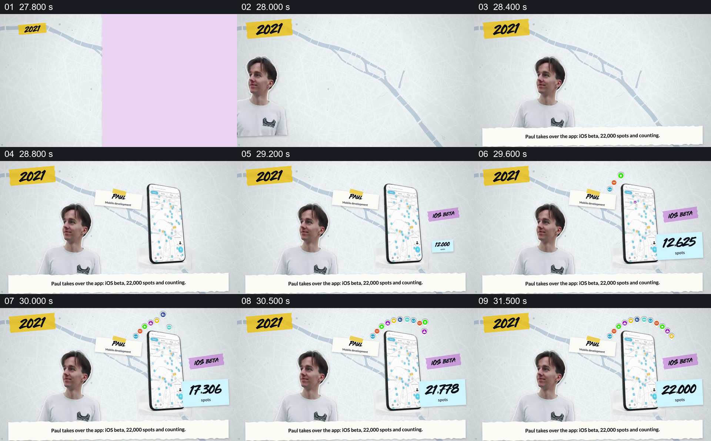

# 让接手者与手机并排，再把地图规模托到画面外

- 作品：案例 002《分批进入与横向遮挡接续》（库内索引名）。
- 原片范围：00:27.700–00:32.300，含起点、不含终点；[完整原片](../video.mp4)｜[本卡片段](c05.mp4)。片段内时间从原片 27.700 秒开始。
- 边界依据：从 2021 年接手者出现，到手机、测试状态与 22,000 地点的结果同时可读；下一段转入全球尺度。
- 观察方式：核看完整原片 64 帧总览及本卡九宫格。未独立完成连续原速观看与听审；精确运动、停顿、声音落点和新题材迁移效果仍待核验。作品中的年份、人物关系与数字仅按画面呈现记录，未独立查证。

## 原画面具体怎样设计

**先确定接手的人。** 紫色纸面退开后，左上出现“2021”，Paul 的白衣人物剪影位于左侧偏下。底部纸条称 Paul 接手应用，并提到 iOS 测试和 22,000 个地点；姓名与“Mobile development”职责卡随后出现在人物右上方。

**在人物右侧建立可以辨认的产品。** 一部竖直手机出现在右边，屏幕里是浅色地图及多枚蓝色、橙色地点标记；紫色“IOS BETA”标签紧邻手机。Paul 保持在左侧，手机为右侧视觉中心，角色名称、实际界面与测试阶段因此可同时阅读。

**把屏幕内的集合扩展成周边构图。** 蓝色小便笺在手机右下出现，数值从 12,000 变化为 22,000 spots；手机上缘外侧逐渐排列一弧彩色地点图标。约 00:31.5，人物、手机、状态标签、外部弧形标记和 22,000 便笺同时保留。小图标在屏幕外扩展了地点集合的视觉范围，但不能据此推断其为真实新增位置。

## 为什么这样设计，好在哪里

这段不是只把负责人和增长数字并列：手机内地图先让观众知道“地点”指什么，外部弧形标记再把原本很小的屏幕内容延伸到手机周围，计数则单独承担规模阅读。Paul 与设备共处一个画面，使“谁接手”和“接手的是什么”保持联系。

若只把 22,000 放大，数量可以被记住，但产品界面与人员角色会退到幕后；若只留下手机和头像，则阶段变化缺少可识别的结果。片中 22,000 和测试状态是作品中的陈述，不视为本次已核实事实。

## 完整照排指令

以[本地原片](../video.mp4) 27.700–32.300 秒为准，16∶9，1280×720，30 帧/秒。位置按画幅百分比取近似值，拍点精度受抽帧间隔限制。

### 用料

- 【街网底图】沿用相邻段的浅灰街网和斜河道。备【年份】【接手者肖像】【接手者姓名】【接手者职责】【阶段说明】，肖像须可抠出头肩并保存向画内的视线，底注只用一句短文陈述可核对阶段。
- 【手机地图】用这一阶段的真实竖屏地图截图或可控录屏，能辨出地图纹理和多个类别点。【外溢标记】使用屏内同一类标记造型与配色，表达同一集合向机外展开。【产品阶段】准备一条短标识，【规模起值】【规模终值】【规模单位】与手机所示集合一致，提供历史记录或发布页面、截止日期和统计口径。保持累计过程与终值的区别。

### 按源时刻摆放

1. **27.700–28.300 秒。** 浅紫遮板向右行，露出静态【街网底图】及左上黄贴黑色斜体【年份】。左下接入【接手者肖像】，x13%–38%、头顶约 y32%，躯干沉到底部近满宽撕边纸之后。纸上居中排单行黑字【阶段说明】。
2. **约 28.500–29.100 秒。** 右侧竖手机从底端升起，从露出黑顶边到完全直立，只带轻微向右倾斜。落位 x62%–78%、y14%–76%，黑细外框、白屏，屏内充满点位的【手机地图】。人和手机之间偏上放薄白姓名卡，黑粗【接手者姓名】下排小黑【接手者职责】，卡内留黄强调。手机从首次露面一直保留到末拍，允许用同一静态截图随手机壳上升。实际持续操作时准备足够连续录屏，避免循环造成地图位置跳变。
3. **约 29.100–30.700 秒。** 手机右侧上方贴斜紫签，用黑色粗斜字【产品阶段】，下方分别排青色数字便笺里的黑粗【规模起值】到【规模终值】，底边小一档【规模单位】。约 29.3 秒外部第一批彩色圆点从手机上沿附近向上浮，分次由左向右搭成顶部小拱弧，拱跨约 x54%–85%，弧顶约 y8%。屏内点位继续可见，外溢点在机框外独立叠加。计数先快后慢，原片从 12000 到 22000，约 30.700 秒定在终值。
4. **约 30.700–32.300 秒。** 让手机地图、拱弧、阶段签、最终数字、人物和底注共同保持。约 32.1 秒后浅黄下一场色面从左横过，依次遮掉人物、手机和数字。按 32.300 秒切出，保留遮挡的前进方向。

### 局部采用

若只具备接手者与可信手机界面，可用 27.700–约 29.100 秒的人物与产品建立，从外溢和计数入场前切出。若采用画面后半，屏内点、机外点与数字须来自同一集合，需保有手机作为出发参照。

### 验证状态

本轮按 5 帧/秒原片时间序列核对约 28.500 秒手机露头、29.300 秒近起值与最早外溢标记、30.700 秒拱弧和终值一并留存。连续原速、逐帧边界、听审和换料待核。
