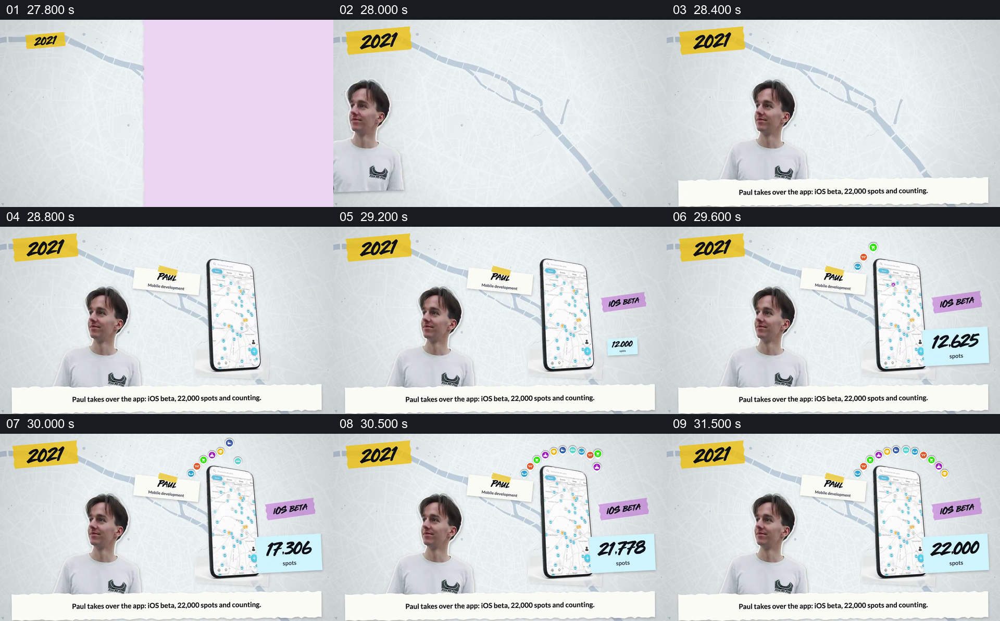

# 把接手者与正在扩大的手机地图放在一起

- 作品：案例 002《分批进入与横向遮挡接续》（索引名称）。
- 原片范围：00:27.700–00:32.300，含起点、不含终点；[完整原片](../video.mp4)｜[本卡完整片段](c05.mp4)。
- 观察方式：按整片 64 宫格顺序检查，并在原片各段约每秒抽帧、对交界加密观察；本卡分镜为原片真实帧。未连续原速观看或听审，声音内容与语气未确认。

## 原画面具体怎样设计

2021 年份出现，人物 Paul 位于左侧，姓名牌标注移动开发；右侧竖起一部显示地图的手机。手机外侧逐个出现彩色地点标记，紫色便签写着 iOS beta，蓝色便签上的数量上升到 22,000。底部文字称 Paul 接手应用，并将 iOS 测试版与地点数量一起介绍。

## 为什么这样设计，好在哪里

人物和手机同时留在画面里，职责牌把人的角色与产品联系起来；地图内外的地点图标和最终数字共同体现原片想展示的规模。外部弧形标记是强调与装饰，不应逐个理解为真实位置；画面上的数量和产品阶段仍需来源核对。 以上为作品分析，不代表作者自述或已测量的观众反应。

## 可直接使用的创意指令

当需要交代某人接手产品以及同期可核实的进展时，先用人物和清楚的职责标签建立身份，再把该阶段的产品主要界面放在旁边，使工作对象始终可见。选取一种与实际进展直接相关的指标或状态，例如已验证的数量、发布阶段或覆盖范围，在界面稳定后逐步显露并保留最终值。图标可以概括内容，但应与真实信息区分；指标的时间、单位和来源必须准确，不能把视觉增长当作产品表现已获验证。
