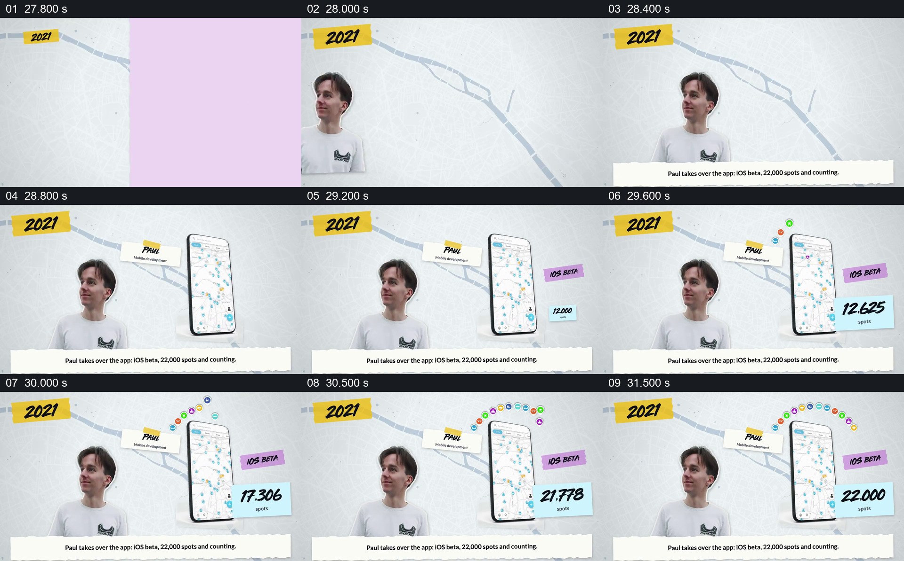

# 让接手者与手机并排，再把地图规模托到画面外

- 作品：案例 002《分批进入与横向遮挡接续》（库内索引名）。
- 原片范围：00:27.700–00:32.300，含起点、不含终点；[完整原片](../video.mp4)｜[本卡片段](c05.mp4)。片段内时间从原片 27.700 秒开始。
- 边界依据：从 2021 年接手者出现，到手机、测试状态与 22,000 地点的结果同时可读；下一段转入全球尺度。
- 观察方式：核看完整原片 64 帧总览及本卡九宫格。未独立完成连续原速观看与听审；精确运动、停顿、声音落点和新题材迁移效果仍待核验。作品中的年份、人物关系与数字仅按画面呈现记录，未独立查证。

## 原画面具体怎样设计

**先确定接手的人。** 紫色纸面退开后，左上出现“2021”，Paul 的白衣人物剪影位于左侧偏下。底部纸条称 Paul 接手应用，并提到 iOS 测试和 22,000 个地点；姓名与“Mobile development”职责卡随后出现在人物右上方。

**在人物右侧建立可以辨认的产品。** 一部竖直手机出现在右边，屏幕里是浅色地图及多枚蓝色、橙色地点标记；紫色“IOS BETA”标签紧邻手机。Paul 保持在左侧，手机为右侧视觉中心，角色名称、实际界面与测试阶段因此可同时阅读。

**把屏幕内的集合扩展成周边构图。** 蓝色小便笺在手机右下出现，数值从 12,000 变化为 22,000 spots；手机上缘外侧逐渐排列一弧彩色地点图标。约 00:31.5，人物、手机、状态标签、外部弧形标记和 22,000 便笺同时保留。小图标在屏幕外扩展了地点集合的视觉范围，但不能据此推断其为真实新增位置。

## 为什么这样设计，好在哪里

这段不是只把负责人和增长数字并列：手机内地图先让观众知道“地点”指什么，外部弧形标记再把原本很小的屏幕内容延伸到手机周围，计数则单独承担规模阅读。Paul 与设备共处一个画面，使“谁接手”和“接手的是什么”保持联系。

若只把 22,000 放大，数量可以被记住，但产品界面与人员角色会退到幕后；若只留下手机和头像，则阶段变化缺少可识别的结果。片中 22,000 和测试状态是作品中的陈述，不视为本次已核实事实。

## 可直接使用的创意指令

需要说明某位负责人接手产品并呈现阶段进展时，准备能够真实标识负责人的材料、能辨认主要用途的产品界面，以及有来源的阶段状态与数量。先让角色位置和职责成立，再在旁边建立产品；从界面中选择最能代表其内容的一类对象，通过界面外的适度延伸帮助观众识别集合，同时把数字放在独立、可读的位置。

最终保留角色、产品、阶段标识和结果之间的对应，直到主要信息读清。人物可替换为团队或负责环节，手机可换成网页、设备或实物；外扩标记和计数的位置及数量按材料调整。没有可靠统计时只展示有依据的状态，不让装饰性图标伪装成逐条真实记录。
