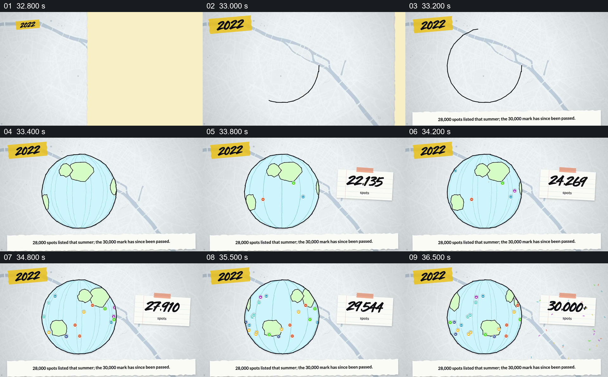

# 把地点增长从平面地图扩展到转动的地球

- 作品：案例 002《分批进入与横向遮挡接续》（索引名称）。
- 原片范围：00:32.700–00:37.300，含起点、不含终点；[完整原片](../video.mp4)｜[本卡完整片段](c06.mp4)。
- 观察方式：按整片 64 宫格顺序检查，并在原片各段约每秒抽帧、对交界加密观察；本卡分镜为原片真实帧。未连续原速观看或听审，声音内容与语气未确认。

## 原画面具体怎样设计

2022 年标签下，一条线画成圆，填出手绘地球和陆地；不同颜色的地点图标逐渐出现在地球表面，球面持续转动。右侧纸片上的数字从两万多递增，最终显示 30,000+ 并出现彩色碎片。底部文字称当年夏天列有 28,000 个地点，之后跨过 30,000；后一个数字在原文中并未限定仍发生在 2022 年。

## 为什么这样设计，好在哪里

球面让此前的地点集合获得更大的空间范围，持续出现的标记与旁侧总数形成相互对应的视觉印象；最终里程碑有明确的收束状态。绘制的大陆、标记和数字动画是解释性图形，并不证明地点的精确分布或每一步增长过程。 以上为作品分析，不代表作者自述或已测量的观众反应。

## 可直接使用的创意指令

当地点集合确实跨区域扩展，而且统计时点和总量有依据时，可先建立便于辨认的地球或区域轮廓，再让代表地点的标记逐步出现，并在旁边同步显示清楚的总数和单位。保留标记与统计对象的关系，使增长不是孤立的数字滚动；达到真实里程碑后给结果足够阅读时间，再接下一阶段。若画面只是示意分布，明确不代表精确坐标；不同年份或“此后”发生的数值变化要标明各自时点，不能混成同一年的事实。
