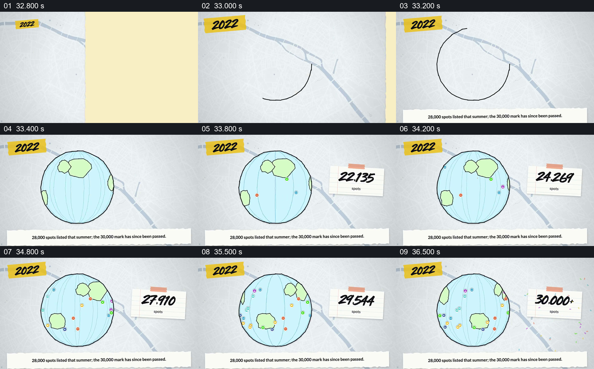

# 把地点集合放到地球上，并以计数收束规模变化

- 作品：案例 002《分批进入与横向遮挡接续》（库内索引名）。
- 原片范围：00:32.700–00:37.300，含起点、不含终点；[完整原片](../video.mp4)｜[本卡片段](c06.mp4)。片段内时间从原片 32.700 秒开始。
- 边界依据：从地球轮廓建立，到地点、总数和里程碑同时出现；随后进入网站改版。
- 观察方式：核看完整原片 64 帧总览及本卡九宫格。未独立完成连续原速观看与听审；精确运动、停顿、声音落点和新题材迁移效果仍待核验。作品中的年份、人物关系与数字仅按画面呈现记录，未独立查证。

## 原画面具体怎样设计

**以新的空间尺度替换手机。** 黄色纸面退开，左上年份为“2022”；地图底纹上先出现一段黑色弧线，在 00:33.0–00:33.4 的源帧中形成蓝色球面、经线和绿色陆地。球体位于左侧偏中，右侧暂时留出空位，底部纸条说明当年夏天记录了 28,000 个地点，此后超过 30,000。

**让地理分布与数量各占一个阅读位置。** 彩色地点标记逐渐出现在球面，右侧贴有胶带的横线纸显示“spots”计数；分镜中数值从 22,135、24,269 变化为 27,910、29,544，最后显示“30,000+”。不同源帧中陆地和标记所在的球面位置发生变化，但抽帧不足以确认连续旋转的全部运动方式。

**以里程碑状态结束。** 球面、不同颜色的点和右侧“30,000+”共同保留，周围出现少量彩色碎片。球面提示地点集合的跨区域空间，便笺负责读出数量；片中底部文字区分了当年 28,000 与此后超过 30,000 的时间关系。

## 为什么这样设计，好在哪里

球面把上一阶段屏幕里的地点集合转换到更大的观察尺度：先有地球轮廓，后有点位，观众能把数目的增长放进一个空间里理解。右侧计数不覆盖球体，规模和地点分布可以同时被看到；最后的“30,000+”将增长过程收成一个明确结果。

点位是示意，画面并没有提供每个地点的坐标或统计来源。只有数值而没有球面，跨地区的空间印象会减弱；只有球面而没有计数，观众则难以从少量可见标记得知片中声称的总规模。

## 完整照排指令

以[本地原片](../video.mp4) 32.700–37.300 秒为准，16∶9，1280×720，30 帧/秒。位置按画幅百分比取近似值，拍点精度受抽帧间隔限制。

### 用料

- 【街网底图】沿用前段浅灰斜河道。【年份】【起始量】【阶段量】【最新量】【地点单位】【阶段说明】共用地区范围与分类口径，附相应日期和可打开原始记录。超过门槛的【最新量】保留加号；画中增长过程只表示计数动画。
- 【地球陆地】【地点标记】准备可跨圆边接续的简化陆块和同一地点集合的分类圆点。若采用抽样示意，在说明中标明。地球内陆块与点位共用滚动层，点与地理位置相对固定。

### 按源时刻摆放

1. **32.700–33.300 秒。** 浅黄板向右让出【街网底图】，左上 x4%、y4% 露出黄贴纸，黑粗斜字【年份】。左半近画心沿细黑线绘圆，完成后落在 x20%–58%、y14%–80%。底部近满宽撕边白纸随圆建立，居中一行黑色小字【阶段说明】。先让轮廓画完，再填淡青、压出细经线及带黑边的浅绿【地球陆地】。
2. **33.300–35.300 秒。** 右侧 x67%–95%、y25%–59% 带薄阴影的白方签压在地图上，顶边一条短橙胶带。黑色粗斜【起始量】居中，下置更小的【地点单位】。从约 33.700 秒起，彩色【地点标记】陆续出现，随着陆块从左向右缓移，并经地球圆边遮罩出入。数值同时抬升，约 35.100 秒短停于【阶段量】，再升至【最新量】。用 22000、28000、30000+ 的原片相对节奏换成新项目的三个节点。
3. **35.300–37.300 秒。** 右侧数字跨到【最新量】时出现短散彩屑，随后数字和单位稳住。圆内陆块和点位仍慢慢滚，直到蓝板遮住对应区域。使用静态陆块及标记做统一位移时，禁止把点作为独立悬浮装饰停在原处。首轮与终值之间禁止循环回起始状态。约 37.1 秒蓝色下一场遮板从左进，按 37.300 秒接出。

### 局部采用

只有一个可信终值时，可用约 35.700–37.300 秒的完成地球与数字，省去三段计数。缺少地理定位时，标记只能明确作为示意。

### 验证状态

本轮以 5 帧/秒原片画序复核 33.100 秒空圆、35.300 秒阶段量、35.700 秒终点散彩及末拍继续转动的地球。逐帧切点、原速听看与换料待核。
