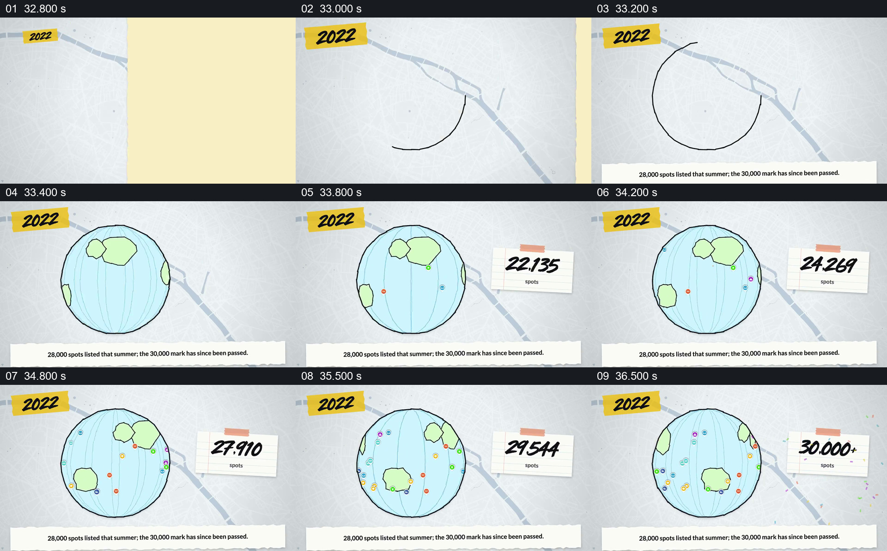

# 把地点集合放到地球上，并以计数收束规模变化

- 作品：案例 002《分批进入与横向遮挡接续》（库内索引名）。
- 原片范围：00:32.700–00:37.300，含起点、不含终点；[完整原片](../video.mp4)｜[本卡片段](c06.mp4)。片段内时间从原片 32.700 秒开始。
- 边界依据：从地球轮廓建立，到地点、总数和里程碑同时出现；随后进入网站改版。
- 观察方式：核看完整原片 64 帧总览及本卡九宫格。未独立完成连续原速观看与听审；精确运动、停顿、声音落点和新题材迁移效果仍待核验。作品中的年份、人物关系与数字仅按画面呈现记录，未独立查证。

## 原画面具体怎样设计

**以新的空间尺度替换手机。** 黄色纸面退开，左上年份为“2022”；地图底纹上先出现一段黑色弧线，在 00:33.0–00:33.4 的源帧中形成蓝色球面、经线和绿色陆地。球体位于左侧偏中，右侧暂时留出空位，底部纸条说明当年夏天记录了 28,000 个地点，此后超过 30,000。

**让地理分布与数量各占一个阅读位置。** 彩色地点标记逐渐出现在球面，右侧贴有胶带的横线纸显示“spots”计数；分镜中数值从 22,135、24,269 变化为 27,910、29,544，最后显示“30,000+”。不同源帧中陆地和标记所在的球面位置发生变化，但抽帧不足以确认连续旋转的全部运动方式。

**以里程碑状态结束。** 球面、不同颜色的点和右侧“30,000+”共同保留，周围出现少量彩色碎片。球面提示地点集合的跨区域空间，便笺负责读出数量；片中底部文字区分了当年 28,000 与此后超过 30,000 的时间关系。

## 为什么这样设计，好在哪里

球面把上一阶段屏幕里的地点集合转换到更大的观察尺度：先有地球轮廓，后有点位，观众能把数目的增长放进一个空间里理解。右侧计数不覆盖球体，规模和地点分布可以同时被看到；最后的“30,000+”将增长过程收成一个明确结果。

点位是示意，画面并没有提供每个地点的坐标或统计来源。只有数值而没有球面，跨地区的空间印象会减弱；只有球面而没有计数，观众则难以从少量可见标记得知片中声称的总规模。

## 可直接使用的创意指令

当项目确有跨地区的对象集合和可靠的阶段总数时，先决定观众需要看到的是城市、国家还是全球尺度，建立相应的可辨认空间容器。随后在容器内以代表性标记表达分布，在邻近位置展示相同统计口径下的数量变化；用明确时间说明历史值和之后达到的里程碑，不把不同时间的数字混成一次同时发生的记录。

结果阶段保留空间对象与最终数值，让观众既能知道范围，也能读出规模。球体可换成地图、建筑平面或其他适合范围的结构，标记形状、色彩与数值载体均可变化；保留的是“范围—代表对象—可信总数”三者的关系。若坐标或总量没有依据，应标明示意，不能暗示点位和数字逐一对应。
