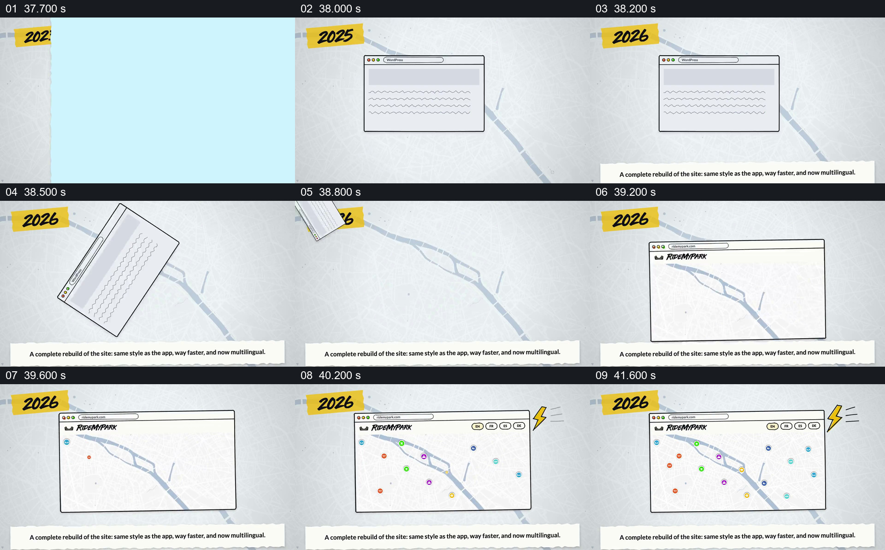

# 用旧窗口退出、新地图窗口建立来表现网站重建

- 作品：案例 002《分批进入与横向遮挡接续》（库内索引名）。
- 原片范围：00:37.600–00:42.300，含起点、不含终点；[完整原片](../video.mp4)｜[本卡片段](c07.mp4)。片段内时间从原片 37.600 秒开始。
- 边界依据：从旧网页的年份变换和建立，到新网页、地图标记及功能符号形成完整结果；之后切到团队介绍。
- 观察方式：核看完整原片 64 帧总览及本卡九宫格，并在 00:37.6–00:39.8 对约每 0.2 秒源帧做加密核对。未独立完成连续原速观看与听审；精确运动、停顿、声音落点和新题材迁移效果仍待核验。作品中的年份、人物关系与数字仅按画面呈现记录，未独立查证。

## 原画面具体怎样设计

**旧窗口伴随年份进入。** 浅蓝遮挡后，一张浏览器样式的小窗口位于中央，窗口顶栏写有“WordPress”，内部是灰色内容块和线条示意。源帧中左上黄色年份标签先后显示 2024、2025、2026，而旧窗口在这一组变化中保持。地图底纹始终在后方，底部纸条描述网站被重新构建、风格与应用一致，并提到速度和多语言。

**让旧版退场，把同一位置交给新版。** 约 00:38.4–00:38.8，旧窗口出现倾斜并向画面左上退出；背景地图和左上 2026 标签保留。随后较大的新窗口出现在中间，顶部是 RideMyPark 标识与网址，窗口内部同样呈现浅色地图纹理。这里变化的是前景页面对象，不需要把背景误认为一台真实摄影机在运动。

**在新窗口内建立功能结果。** 从约 00:39.6 起，彩色地点标记出现在新页面地图上；页面右上角依次可见 EN、FR、ES、DE，窗口外右上有黄色闪电符号。最后保留的是一张可以辨认地图、语言入口和速度象征的新窗口，而不是只以一个“已升级”字样结束。

## 为什么这样设计，好在哪里

旧窗口先占据视觉中心，年份在同一画面中更替；因此当窗口后来退出，新页面进入时，观众已有“改版之前”的参照。底层地图纹理持续存在，新窗口内部也呈现地图，使两版的更替仍留在同一项目世界里；语言按钮和闪电分别承担片中对多语言和速度的视觉提示。

两种页面并非对同时存在的功能逐项实测比较；旧页面是线条式示意，闪电也不构成性能证据。若直接展示新版，观众仍能认识页面，却较难仅凭画面理解这是一次重建。具体年份和改版效果均按原片陈述记录。

## 可直接使用的创意指令

讲述真实的产品或页面更新时，先取得足以代表旧版与新版的材料，确定需要比较的是内容结构、使用入口还是已验证的功能变化。让旧版先在稳定空间中被辨认；保留一个共同背景、对象或内容参照，再将旧版交给新版，保证两者的对应关系清楚。

新版建立后，在其实际位置展示少量最重要的变化，如新入口、语言选择或真实页面内容，并保留足够时间阅读。设备外观、背景、转场与符号都可重新设计；核心是观众能辨认前后版本属于同一对象，并看见发生了什么变化。速度、覆盖范围等结论应有独立依据，图标可以说明主张，不能代替性能测量。
