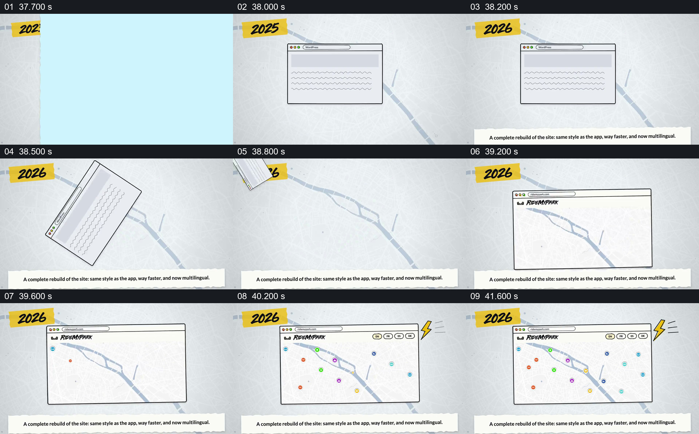

# 用旧窗口退出、新地图窗口建立来表现网站重建

- 作品：案例 002《分批进入与横向遮挡接续》（库内索引名）。
- 原片范围：00:37.600–00:42.300，含起点、不含终点；[完整原片](../video.mp4)｜[本卡片段](c07.mp4)。片段内时间从原片 37.600 秒开始。
- 边界依据：从旧网页的年份变换和建立，到新网页、地图标记及功能符号形成完整结果；之后切到团队介绍。
- 观察方式：核看完整原片 64 帧总览及本卡九宫格，并在 00:37.6–00:39.8 对约每 0.2 秒源帧做加密核对。未独立完成连续原速观看与听审；精确运动、停顿、声音落点和新题材迁移效果仍待核验。作品中的年份、人物关系与数字仅按画面呈现记录，未独立查证。

## 原画面具体怎样设计

**旧窗口伴随年份进入。** 浅蓝遮挡后，一张浏览器样式的小窗口位于中央，窗口顶栏写有“WordPress”，内部是灰色内容块和线条示意。源帧中左上黄色年份标签先后显示 2024、2025、2026，而旧窗口在这一组变化中保持。地图底纹始终在后方，底部纸条描述网站被重新构建、风格与应用一致，并提到速度和多语言。

**让旧版退场，把同一位置交给新版。** 约 00:38.4–00:38.8，旧窗口出现倾斜并向画面左上退出；背景地图和左上 2026 标签保留。随后较大的新窗口出现在中间，顶部是 RideMyPark 标识与网址，窗口内部同样呈现浅色地图纹理。这里变化的是前景页面对象，不需要把背景误认为一台真实摄影机在运动。

**在新窗口内建立功能结果。** 从约 00:39.6 起，彩色地点标记出现在新页面地图上；页面右上角依次可见 EN、FR、ES、DE，窗口外右上有黄色闪电符号。最后保留的是一张可以辨认地图、语言入口和速度象征的新窗口，而不是只以一个“已升级”字样结束。

## 为什么这样设计，好在哪里

旧窗口先占据视觉中心，年份在同一画面中更替；因此当窗口后来退出，新页面进入时，观众已有“改版之前”的参照。底层地图纹理持续存在，新窗口内部也呈现地图，使两版的更替仍留在同一项目世界里；语言按钮和闪电分别承担片中对多语言和速度的视觉提示。

两种页面并非对同时存在的功能逐项实测比较；旧页面是线条式示意，闪电也不构成性能证据。若直接展示新版，观众仍能认识页面，却较难仅凭画面理解这是一次重建。具体年份和改版效果均按原片陈述记录。

## 完整照排指令

以[本地原片](../video.mp4) 37.600–42.300 秒为准，16∶9，1280×720，30 帧/秒。位置按画幅百分比取近似值，拍点精度受抽帧间隔限制。

### 用料

- 【街网底图】沿用相同斜河道。【过渡年份甲】【过渡年份乙】【上线年份】用实际项目节点，附可核对的上线公告或历史页。
- 【旧页面摘要】准备代表旧站的灰色标题线和数行正文，【新页面地图】【新页面标识】【地址文字】【控件字样】取属于同一站点的新页面真实资料。新版所述功能须有可打开的页面或发布说明支持，写进一行【重建说明】。旧窗用灰线呈现时保留其页面类型，避免把说明性的线条当作可读引文。

### 按源时刻摆放

1. **37.600–38.200 秒。** 浅蓝遮板向右退，左上露黄纸黑粗斜【过渡年份甲】，再原位跳到【过渡年份乙】和【上线年份】。浅灰【街网底图】始终在底。中间 x23%–64%、y23%–72% 为略小的黑线矩形旧窗，三枚浅色圆钮和细地址栏压在顶，窗内灰底带分组【旧页面摘要】。
2. **约 38.200–39.000 秒。** 让原窗整体反时针倾转，约 38.4 秒已接近竖斜，从画面左上离开。近画底压近满宽白撕纸，一行黑小字【重建说明】。旧窗离开后短留无遮挡地图和【上线年份】。
3. **约 39.000–40.200 秒。** 新窗从下缘升到 x20%–80%、y16%–78%，更宽，薄黑框近水平，底端停在说明纸上方。顶栏保留三圆钮与【地址文字】；内页左上是黑粗斜【新页面标识】。先显【新页面地图】的斜河线，随后分批加彩点及右上四枚独立的圆角【控件字样】。框从初露到切出持续存在，可用静态截图分图层显现，页面内应沿用同一地图位置。
4. **约 40.200–42.300 秒。** 窗右上外侧出现黄闪电和三笔短黑速度线，保持黑边、地图、全部点与控件同在。短暂停留，最后白色遮板从左经过，按 42.300 秒边界切出。两扇窗口各有出入过程，中间可见原底，禁用旧窗内交叉淡换来跳过让位动作。

### 局部采用

只有新站资料时，从约 39.000 秒下方入窗到 42.300 秒独立使用，以新界面建立为主题。若呈现网站重建，须交代两扇窗所属的版本。

### 验证状态

本轮以 5 帧/秒原片画序检查约 38.400 秒旧窗旋出、38.600 秒中间空场、39.000 秒新窗从下方入、40.200 秒点位和右侧闪电同场。原速播放、逐帧边界、听审和换料待核。
