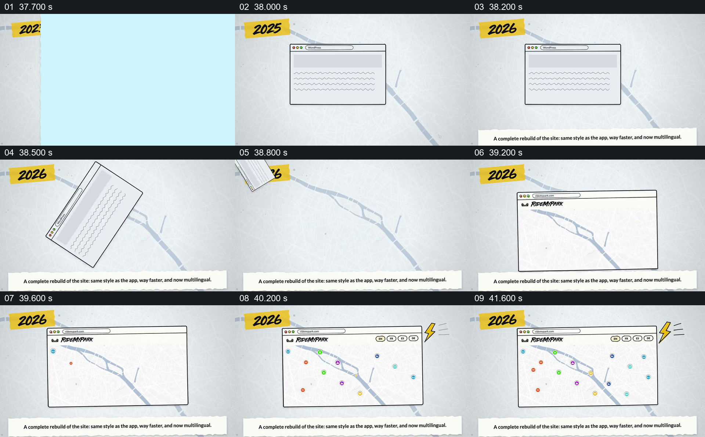

# 先呈现旧页面，再换成重建后的地图窗口

- 作品：案例 002《分批进入与横向遮挡接续》（索引名称）。
- 原片范围：00:37.600–00:42.300，含起点、不含终点；[完整原片](../video.mp4)｜[本卡完整片段](c07.mp4)。
- 观察方式：按整片 64 宫格顺序检查，并在原片各段约每秒抽帧、对交界加密观察；本卡分镜为原片真实帧。未连续原速观看或听审，声音内容与语气未确认。

## 原画面具体怎样设计

画面先出现标为 2025 的年份和一个写有 WordPress 的简化浏览器窗口；年份随后变为 2026，旧窗口倾斜移走。新窗口进入原来的画面，显示 RideMyPark 标志和地图，地点标记陆续补齐，顶部出现 EN、FR、ES、DE 等语言按钮，右侧配有闪电图形。底部文字称网站被重建，与应用风格一致、速度更快并支持多语言。

## 为什么这样设计，好在哪里

旧窗口先占据中心，再把位置交给新窗口，使“更换”有清楚的前后状态；新界面的地点、语言按钮和闪电分别帮助辨认片中想强调的内容。它们是画面内的示意与主张，无法单独证明真实性能、实际支持语言或页面的历史样貌。 以上为作品分析，不代表作者自述或已测量的观众反应。

## 可直接使用的创意指令

当旧版与新版确有可查的差异，并希望概括一次改版时，选取同一产品前后可比较的界面或清楚标注的示意，先建立旧状态，再让新状态在相近位置接管。只突出对观众有意义且已证实的变化，例如具体功能、语言或经测量的速度；用标签和必要的局部展示指向变化位置，给新版留出可读时间。视觉替换是讲述关系，不能代替对实际产品、指标和变更时间的核实。
